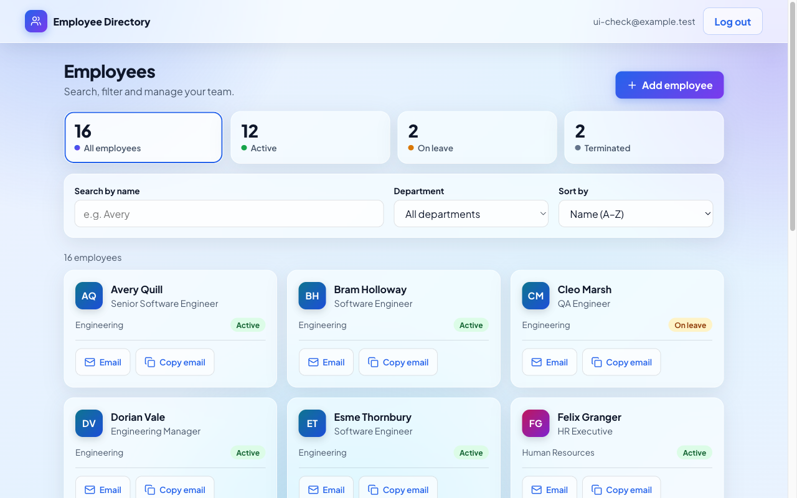
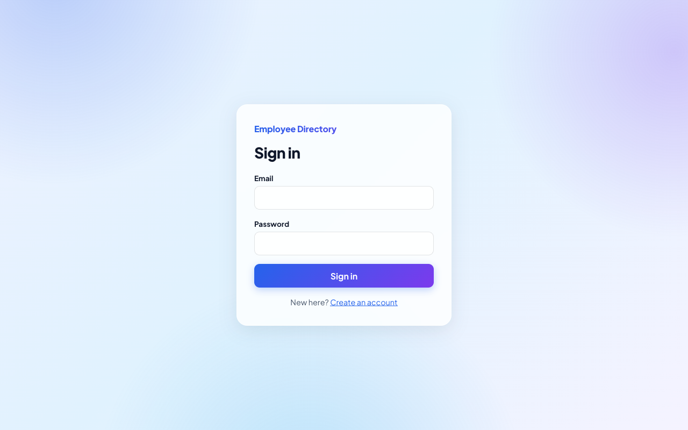
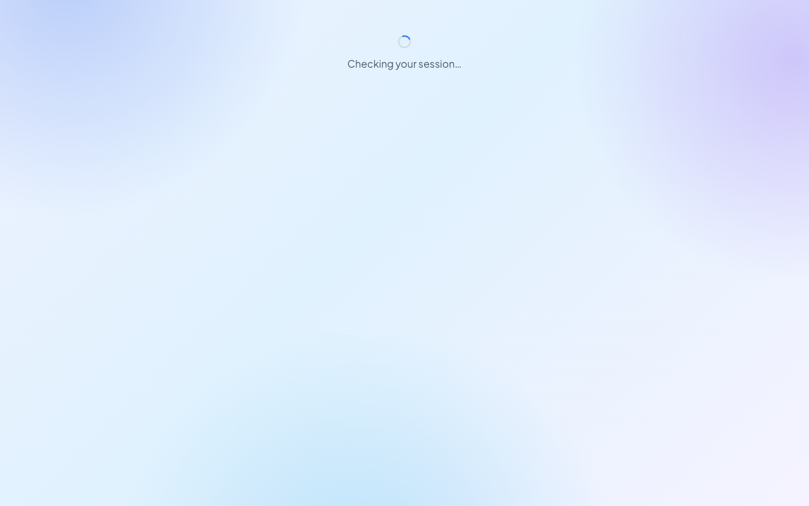
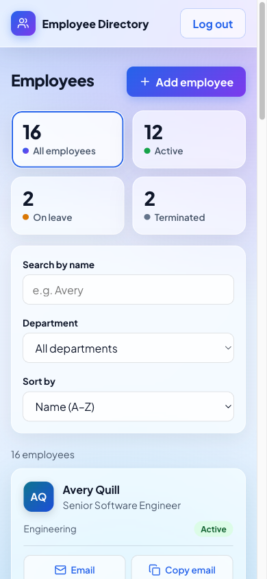
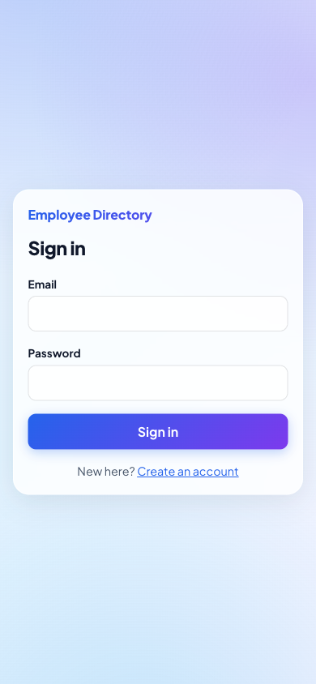
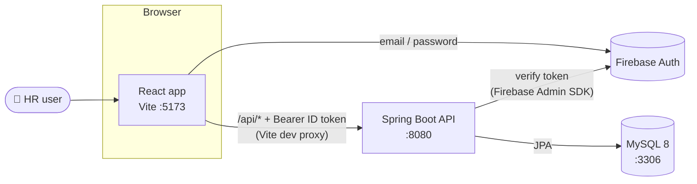
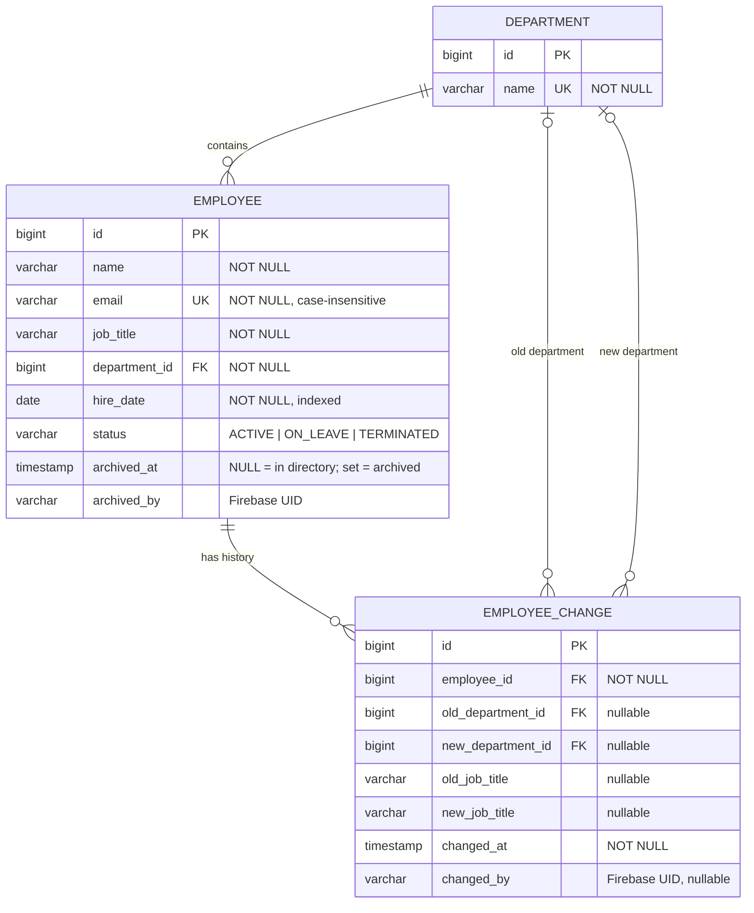

<div align="center">

# 👥 Employee Directory (HR)

**A small, secure, local-only HR directory: search, filter, view, add, edit and archive employees, with an audit trail for every department and job-title change.**




</div>

---

## 📑 Contents

- [Features](#-features)
- [Screenshots](#-screenshots)
- [Tech stack](#-tech-stack)
- [Architecture](#-architecture)
- [Project structure](#-project-structure)
- [Getting started](#-getting-started)
  - [1. Prerequisites](#1-prerequisites)
  - [2. Database](#2-database)
  - [3. Firebase setup](#3-firebase-setup-one-time)
  - [4. Quick start: one command](#4-quick-start-one-command)
  - [5. Run the API manually](#5-run-the-api-manually)
  - [6. Run the web app manually](#6-run-the-web-app-manually)
- [API reference](#-api-reference)
- [Data model](#-data-model)
- [Testing](#-testing)
- [Troubleshooting](#-troubleshooting)
- [Security rules](#-security-rules)
- [Further documentation](#-further-documentation)

---

## ✨ Features

| | Feature | Details |
|---|---|---|
| 🔐 | **Firebase sign-in** | Email/password login and logout. Signed-out users are always redirected to `/login`. The API verifies a Firebase ID token on **every** request. |
| 🔎 | **Search & filter** | Case-insensitive name search plus a department filter. They combine with AND, are debounced, and are kept in the URL so you can share or bookmark them. |
| 🗂️ | **Three views** | **Tiles**, **List** or **Table**. The choice is kept in the URL (`?view=`) and remembered per browser. Table column headers sort the list. |
| ✏️ | **Add & edit** | Validated forms show field-level errors, including a clear message for a duplicate email (409). |
| 🗃️ | **Archive (soft delete)** | Delete sits behind a confirmation dialog. It **archives** the employee and never removes data or history. |
| 🧾 | **Audit trail** | Each department or job-title change writes a row to `employee_change` in the same transaction. |
| 📱 | **Responsive** | Checked at 1280 px and 390 px: no horizontal scroll, and every control is at least 44 px. |
| 📊 | **SQL reports** | Five report queries: headcount, recent hires, change history, status counts and empty departments. |

---

## 📸 Screenshots

<table>
  <tr>
    <th>Login (desktop)</th>
    <th>Employee details</th>
  </tr>
  <tr>
    <td></td>
    <td></td>
  </tr>
  <tr>
    <th>Directory (mobile, 390 px)</th>
    <th>Login (mobile)</th>
  </tr>
  <tr>
    <td align="center"></td>
    <td align="center"></td>
  </tr>
</table>

---

## 🧰 Tech stack

| Layer | Technology | Folder |
|---|---|---|
| **Database** | MySQL 8 | [`db/`](db) |
| **API** | Java 21, Spring Boot 4.1.2, Spring Web MVC, Spring Data JPA, Bean Validation, Firebase Admin SDK 9.9 | [`api/`](api) |
| **Web** | React 19, TypeScript, Vite 8, React Router 7, Firebase JS SDK 13, oxlint | [`web/`](web) |
| **Auth** | Firebase Authentication (email/password) | |

---

## 🏗️ Architecture



- The browser calls `/api/...` on the web app's **own address**. The Vite dev server forwards those requests to `http://localhost:8080`, so the API never has to be exposed.
- Hibernate runs with `ddl-auto=validate`: `db/schema.sql` owns the schema, and the API refuses to start if its entities don't match it.
- Entities never leave the service layer. Controllers only accept and return record DTOs.

---

## 📁 Project structure

```text
Employee-Directory/
├── api/                          # Spring Boot REST API
│   ├── src/main/java/com/rapidm3/employeedirectory/
│   │   ├── config/               # Firebase + CORS configuration
│   │   ├── controller/           # EmployeeController, DepartmentController
│   │   ├── dto/                  # Request/response records, ApiError
│   │   ├── entity/               # Employee, Department, EmployeeChange, EmployeeStatus
│   │   ├── exception/            # Domain exceptions + GlobalExceptionHandler
│   │   ├── repository/           # Spring Data JPA repositories
│   │   ├── security/             # FirebaseAuthFilter, TokenVerifier
│   │   └── service/              # EmployeeService (business rules + audit)
│   └── src/test/                 # 41 integration tests against MySQL
├── web/                          # React + TypeScript + Vite front end
│   └── src/
│       ├── auth/                 # AuthProvider, ProtectedRoute
│       ├── components/           # Cards, table, filters, forms, dialogs, toasts
│       ├── pages/                # Auth, Directory, Employee, EmployeeForm
│       └── services/api.ts       # Typed API client (attaches the ID token)
├── db/
│   ├── schema.sql                # Tables, keys, constraints, indexes
│   ├── seed.sql                  # 4 departments, 16 fake employees, 5 change rows
│   ├── queries.sql               # The five report queries
│   ├── er-diagram.mmd            # Mermaid ER diagram
│   └── migrations/               # One-off upgrade scripts
├── docs/                         # Run guide, test checklist, SQL checks, screenshots
├── run.sh                        # One-command local startup
├── implementation.md             # Design spec + decisions (§21)
├── task.md                       # Task breakdown
└── PROGRESS.md                   # Task status and evidence
```

---

## 🚀 Getting started

### 1. Prerequisites

> Versions checked on 2026-11-09.

| Software | Version | Notes |
|---|---|---|
| JDK | 17+ (tested with 21.0.13) | You don't need to install Maven: `api/mvnw` downloads it. |
| MySQL | 8.x (tested with 8.4.13) | Must run **locally**. |
| Node.js + npm | Node 20+ (tested with 24.22.1 / npm 11.19.1) | |
| Firebase | A **personal** project | The free Spark plan is enough. |

```bash
java -version && mysql --version && node --version && npm --version
```

### 2. Database

Use a **local** MySQL only. These commands assume the `root` user; add `-p` if it has a password.

```bash
mysql -u root -e "CREATE DATABASE IF NOT EXISTS employee_directory"
mysql -u root employee_directory < db/schema.sql        # ⚠️ DROPS and recreates the 3 tables
mysql -u root employee_directory < db/seed.sql          # 4 departments, 16 fake employees, 5 change rows
mysql -u root -t employee_directory < db/queries.sql    # run the five report queries

# Test database (the API tests rebuild it from the same scripts on every run)
mysql -u root -e "CREATE DATABASE IF NOT EXISTS employee_directory_test"
```

<details>
<summary><b>Upgrading a database created before the archive (delete) feature?</b></summary>

Run the one-time migration instead of rebuilding, so you keep your data:

```bash
mysql -u root employee_directory < db/migrations/2026-11-09-employee-archive.sql
```

The API refuses to start against a database that is missing the `archived_at`/`archived_by` columns (`ddl-auto=validate`).
</details>

### 3. Firebase setup (one time)

1. In the [Firebase console](https://console.firebase.google.com), choose **Add project**. You don't need Google Analytics.
2. Go to **Build → Authentication → Get started → Sign-in method** and enable **Email/Password**.
3. Go to **Project settings → General → Your apps** and add a **Web app**. Copy its config values into `web/.env.local` (see [step 6](#6-run-the-web-app-manually)).
4. Go to **Project settings → Service accounts → Generate new private key**. Save the JSON **outside this repository**, for example `~/.secrets/employee-directory-firebase.json`.

> [!CAUTION]
> The service-account JSON is a real secret. Never commit it, never paste it into chat or AI tools, and never put it in `web/`.

### 4. Quick start: one command

After steps 1–3, create `web/.env.local` (step 6) and run:

```bash
./run.sh              # checks MySQL, creates + seeds the DB on first run, starts API (:8080) and web (:5173)
./run.sh --reset-db   # same, but first rebuilds the DB from schema.sql + seed.sql (drops the tables)
```

Then open **http://localhost:5173**. **Ctrl+C** stops both apps.

The script uses `GOOGLE_APPLICATION_CREDENTIALS` if it is set. Otherwise it falls back to a git-ignored `web/*firebase-adminsdk*.json`. It also checks that ports 8080 and 5173 are free and runs `npm install` on the first run.

### 5. Run the API manually

```bash
cd api
export GOOGLE_APPLICATION_CREDENTIALS="$HOME/.secrets/employee-directory-firebase.json"
./mvnw spring-boot:run
```

| Environment variable | Default | Purpose |
|---|---|---|
| `DB_URL` | `jdbc:mysql://localhost:3306/employee_directory` | JDBC URL |
| `DB_USERNAME` | `root` | MySQL user |
| `DB_PASSWORD` | *(empty)* | MySQL password. Never commit it. |
| `APP_CORS_ORIGIN` | `http://localhost:5173` | Exact allowed web origin (no wildcard) |
| `APP_AUTH_ENABLED` | `true` | Set to `false` **only** for local curl testing before Firebase exists |
| `GOOGLE_APPLICATION_CREDENTIALS` | | Path to the service-account JSON |

If the credentials are missing, the API **refuses to start**, so it can never run unprotected by accident.

> [!WARNING]
> `APP_AUTH_ENABLED=false ./mvnw spring-boot:run` turns off **all** protection and logs a warning. Use it on your own machine only, never in a demo.

### 6. Run the web app manually

```bash
cd web
cp .env.example .env.local   # then fill in the Firebase web config from step 3.3
npm install
npm run dev                  # http://localhost:5173
```

| `web/.env.local` key | Purpose |
|---|---|
| `VITE_FIREBASE_API_KEY`, `VITE_FIREBASE_AUTH_DOMAIN`, `VITE_FIREBASE_PROJECT_ID`, `VITE_FIREBASE_APP_ID` | Firebase web config. These identify the project and are not server secrets. |
| `VITE_REGISTER_PATH` | Unlisted path of the Register page, e.g. `/join-<random>`. Leave it empty to have no register page. |
| `VITE_API_BASE_URL` | **Leave empty.** The app then calls `/api` and Vite forwards it to `:8080`. |

Register an account at your `VITE_REGISTER_PATH`, then sign in.

> [!NOTE]
> The login screen does not link to registration. Hiding the path only keeps casual visitors out. The path is visible in the app's JavaScript, and any signed-in Firebase user can use the API.

<details>
<summary><b>Opening the app from another device (phone, tunnel, port forwarding)</b></summary>

Forward **only port 5173**; the API stays private on this machine. Vite listens on `localhost` only, which is what port-forwarding and tunnel tools connect to. To reach it over your LAN instead, run `npm run dev -- --host`. This exposes the dev server to everyone on that network. A tunnel with its own hostname may also need `server.allowedHosts` in `vite.config.ts`. The forwarding comes from the dev server, so a production build would need a reverse proxy doing the same job.
</details>

---

## 📡 API reference

Base URL: `http://localhost:8080` (or `/api` from the web app). Every endpoint requires `Authorization: Bearer <Firebase ID token>`.

| Method | Path | Success | Errors |
|---|---|---|---|
| `GET` | `/employees?name=&departmentId=` | **200** list. Filters are optional and combine with AND; the name match is a case-insensitive substring. | 400 for a non-numeric `departmentId` |
| `GET` | `/employees/{id}` | **200** | 404 (also for archived employees) |
| `POST` | `/employees` | **201** + `Location` header | 400 validation or unknown department, 409 duplicate email |
| `PUT` | `/employees/{id}` | **200** | 400, 404, 409 |
| `DELETE` | `/employees/{id}` | **204**: *archives* the employee | 404 if unknown or already archived |
| `GET` | `/departments` | **200** | |

Any endpoint can also return **401** for a missing, invalid or expired token.

**Request body** (POST / PUT). All fields are required, and `status` is one of `ACTIVE`, `ON_LEAVE` or `TERMINATED` (provisional until HR confirms them):

```json
{
  "name": "Rowan Tate",
  "email": "rowan.tate@example.test",
  "jobTitle": "Analyst",
  "departmentId": 4,
  "hireDate": "2026-01-05",
  "status": "ACTIVE"
}
```

**Error shape** (shared by every error):

```json
{
  "timestamp": "…",
  "status": 409,
  "code": "DUPLICATE_EMAIL",
  "message": "An employee with this email already exists.",
  "fieldErrors": { "email": "Email is already in use." }
}
```

**Archive semantics:** "Delete" never removes data. It sets `archived_at`/`archived_by` and hides the employee from search, details and edit. Their row and change history stay. Their email also stays reserved: a reused email gets a 409 explaining that it belongs to an archived employee. The report queries leave archived employees out.

---

## 🗄️ Data model



**Report queries** (`db/queries.sql`):

1. Headcount per department (departments with zero employees show 0)
2. Hires in the last 90 days
3. One employee's change history, newest first
4. Employees by status
5. Departments with no employees

Two of them are checked by hand in [`docs/sql-verification.md`](docs/sql-verification.md).

---

## 🧪 Testing

```bash
cd api && ./mvnw test               # 41 JUnit / Spring Boot tests against local MySQL
cd web && npm run build && npm run lint
```

- The API tests drive the real filters, controllers, service and JPA layer against `employee_directory_test`, and each test rolls back.
- Firebase is replaced by a Mockito stub of `TokenVerifier`, so the tests need no credentials.
- The manual browser checklist (21 cases) is in [`docs/manual-test-checklist.md`](docs/manual-test-checklist.md).

---

## 🛠️ Troubleshooting

| Symptom | Fix |
|---|---|
| API exits with `Your default credentials were not found` | Set `GOOGLE_APPLICATION_CREDENTIALS` to the service-account JSON path (or use `APP_AUTH_ENABLED=false` locally). |
| `Access denied for user` on startup or tests | Set `DB_USERNAME` / `DB_PASSWORD`, and check that MySQL is running (`brew services list`). |
| `Unknown database 'employee_directory_test'` | Run the `CREATE DATABASE` command from [step 2](#2-database). |
| "Cannot reach the server. Is the API running?" | Start the API (`./run.sh` starts both). From another device, leave `VITE_API_BASE_URL` empty. |
| Browser shows a CORS error | This only happens when `VITE_API_BASE_URL` points straight at the API. The web origin must then equal `APP_CORS_ORIGIN` exactly. |
| Every API call returns 401 | The web app and the API use different Firebase projects. Compare `VITE_FIREBASE_PROJECT_ID` with the service account's `project_id`. |
| Blank page or `auth/invalid-api-key` | `web/.env.local` is missing or incomplete. |
| `Port 8080/5173 is in use` from `run.sh` | A previous run is still alive. Stop it with the `kill <PID>` command the script prints. |

---

## 🔒 Security rules

- 🚫 Never commit `.env.local`, `application-local.properties`, DB passwords or the service-account JSON. `.gitignore` covers these as a safety net.
- 🧪 Use **fake data only**. Seed emails use the reserved `example.test` domain.
- 💻 Run on your **local machine only**. Don't deploy, and don't point the scripts at a shared database.
- 🔑 All SQL is parameterized, CORS allows one exact origin, and error responses never include stack traces.

---

## 📚 Further documentation

| Document | What's inside |
|---|---|
| [`docs/how-to-run-the-project.md`](docs/how-to-run-the-project.md) | Beginner-friendly, step-by-step run guide |
| [`docs/manual-test-checklist.md`](docs/manual-test-checklist.md) | Manual browser test cases and their results |
| [`docs/sql-verification.md`](docs/sql-verification.md) | Report queries checked by hand |
| [`implementation.md`](implementation.md) | Design spec, decisions and open questions (§21) |
| [`task.md`](task.md) / [`PROGRESS.md`](PROGRESS.md) | Task breakdown and current status |
| [`docs/claude-code-notes.md`](docs/claude-code-notes.md) | Notes on working with Claude Code |

<div align="center">
<sub>Built as an HR onboarding project · local development only · fake data only</sub>
</div>
