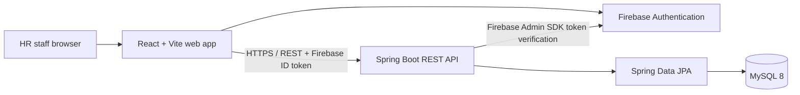
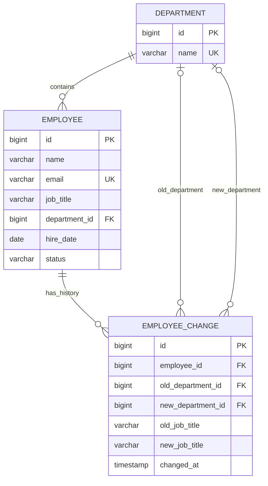

# Employee Directory (HR) — Implementation Specification

**Source of truth:** `Intern 1 - Employee Directory (HR) Onboarding Plan.pdf` (8 pages; dated Oct 28, 2026; mentor shown as @RapidM3).  
**Plan status:** Proposed implementation baseline; mentor approval is still required for explicitly unresolved decisions.  
**Target repository:** `employee-directory` with `db/`, `api/`, and `web/`.  
**Delivery constraint:** Four-day onboarding exercise. Estimates below are person-effort, not a promise that every item fits four calendar days.

---

## 1. Executive summary

Build a small, locally runnable, full-stack Employee Directory for HR staff. Authenticated users can register/sign in, search employees by name, combine that search with a department filter, inspect employee details, and add or edit employees. Data is stored in MySQL 8. A Spring Boot REST API accesses the database. A React application built with Vite provides the UI. Firebase Authentication provides email/password identity.

The database must contain `department`, `employee`, and `employee_change` tables. The change log records department and/or job-title changes. The API must validate input and return clear JSON errors for invalid input (400), unknown IDs (404), and duplicate email (409). The project must include JUnit/Spring Boot tests, SQL setup/seed/query scripts, an ER diagram, a manual test checklist, a README sufficient for a fresh-clone local setup, and a short Claude Code usage note.

The onboarding also requires a mentor-approved fix in a teammate's Inventory Tracker repository, with a regression test and a second mentor-reviewed PR. Both PRs must be reviewed by the mentor. The intern must be able to explain every submitted line.

### Completion outcomes

- **OUT-001:** A fresh clone can be set up and run locally using only the README.
- **OUT-002:** HR user can authenticate and use the directory's required workflows.
- **OUT-003:** Database integrity and API rules are enforced and tested.
- **OUT-004:** Two PRs are opened and mentor-reviewed: Employee Directory and teammate Inventory Tracker fix.
- **OUT-005:** Intern can explain submitted code and defend at least one design decision.
- **OUT-006:** Final 30-minute demo follows the source document's agenda.

## 2. Source register and interpretation

| Source | Evidence used | Interpretation |
|---|---|---|
| PDF p.1 | Goal, app description, done conditions, stack | Defines product scope, stack and completion conditions |
| PDF p.2 | Frontend/identity/tooling/AI stack; token verification; Claude rules and skills | Defines security principle and development workflow |
| PDF p.3 | Additional tools, prohibited actions, task prompt, Day 1 | Defines environment, guardrails and initial design deliverables |
| PDF p.4 | Data model prompt, Day 2 database/API tasks | Defines entities, SQL scripts, seed volume, queries and endpoints |
| PDF p.5 | API errors/tests, Day 3 UI/Auth tasks | Defines API error behavior, UI states and authentication flows |
| PDF p.6 | Day 4 teammate bug fix, README, final PR and demo preparation | Defines cross-repo work and release preparation |
| PDF p.7 | Deliverables, demo agenda, viva questions and security rules | Defines acceptance evidence and knowledge checks |
| PDF p.8 | Remaining rules and daily log | Defines operating constraints and learning record |

No external product research or repository inspection was performed. The plan is based on the supplied PDF and clearly labelled engineering recommendations. The PDF's parsed text and page images were reviewed; no ER diagram, existing codebase, detailed visual design, or actual teammate bug ticket was supplied.

## 3. Facts, recommendations, assumptions and unresolved questions

### 3.1 Facts explicitly stated by the source

- MySQL 8 and SQL; tables: `department`, `employee`, `employee_change`.
- Java 17+; Spring Boot, Spring Web, Spring Data JPA, Bean Validation.
- JUnit and Spring Boot Test.
- React (JS/TS), Vite and CSS.
- Firebase Authentication; Email/Password provider.
- Git feature branches and pull requests.
- Claude Code with team configuration.
- Required user features: register/sign in, employee name search, department filter, employee details, add and edit.
- Required API routes:
  - `GET /employees?name=&departmentId=`
  - `GET /employees/{id}`
  - `POST /employees`
  - `PUT /employees/{id}`
  - `GET /departments`
- Department or job-title changes must create an `employee_change` row.
- SQL scripts: `db/schema.sql`, `db/seed.sql`, `db/queries.sql`.
- Seed data: 4 departments, 15+ fake employees and some change rows.
- SQL query set: department headcount, hires in last 90 days, one employee's change history, employees by status, departments with no employees.
- Integrity checks: reject nonexistent department references and duplicate email.
- API errors: 400, 404 and 409 with clear JSON error bodies.
- Frontend components named in the source: `EmployeeList`, `EmployeeCard`, `SearchBox`, `DepartmentFilter`, `EmployeeDetails`, `EmployeeForm`.
- UI states: loading, empty results and API errors, including duplicate email shown on the form.
- Firebase flows: Register, Login, Logout; wrong password, unknown user, email in use and weak password messages.
- Protect every directory route; signed-out users are sent to Login.
- CORS must allow the Vite development URL only.
- Responsive layout checked at desktop and mobile widths with Playwright screenshots.
- Final manual checks include filter combinations, empty results, duplicate email, mobile width, registration, wrong password, logout and signed-out route protection.
- README covers prerequisites, DB setup, environment variables, Firebase steps, API/UI startup and tests.
- A teammate-approved bug in the Inventory Tracker must be reproduced, fixed minimally, regression-tested and submitted as a PR.
- Never use real employee/customer data or secrets with Claude; never commit `.env`, DB passwords or credentials; only use local DB; no deployment/shared environment without mentor approval; do not push to `main`; do not disable tests or weaken validation; report tests only after actually running and reading results.
- Ask mentor before scope expansion. Raise blockers within 30 minutes.

### 3.2 Important ambiguity / conflict

**SECURITY DECISION — BLOCKER FOR CLAIMING THE API SECURE**

Page 2 states that only the backend can enforce access and that the Firebase ID token must be verified on every protected request. Page 5 labels sending the token to the API and verifying it with Firebase Admin SDK as a stretch goal that may be skipped if the intern can explain it. These cannot both define the same security acceptance level.

**Recommendation:** Implement Firebase ID-token verification in Spring Boot for all protected API endpoints. Treat it as mandatory for a secure end-to-end result, but obtain mentor confirmation because the source's Day 3 schedule calls it optional. If the mentor explicitly waives implementation for this four-day exercise, document the API as locally demonstrative and not securely access-controlled; do not describe React route guards as API security.

### 3.3 Proposed assumptions (must not be mistaken for source facts)

| ID | Proposed assumption / design choice | Why needed | Confirmation |
|---|---|---|---|
| ASM-001 | One Firebase-authenticated HR user role is sufficient; no admin/manager permission matrix | PDF says HR staff sign in but defines no roles | Mentor |
| ASM-002 | Employee fields are `name`, `email`, `jobTitle`, `departmentId`, `hireDate`, `status` | Fields named on p.4 | Confirm exact field constraints |
| ASM-003 | Department has an ID and unique/display name | Required relationship and filter imply it | Mentor |
| ASM-004 | Employee email is unique across all employees, case-insensitive after trimming/normalization | Unique email required; comparison semantics unspecified | Mentor |
| ASM-005 | `employee_change` records old/new department and/or old/new job title, timestamp and employee reference | Required change history; exact audit shape unspecified | Mentor |
| ASM-006 | Employee status is a controlled string/enum; values are not specified | Status query and employee status field required | HR/mentor must supply values |
| ASM-007 | Name search is case-insensitive substring matching; blank name means no name constraint | User-facing search semantics unspecified | Mentor |
| ASM-008 | Name and department filters combine with logical AND | “Must work together” implies combined filtering | Mentor |
| ASM-009 | Employee list returns a bounded response; pagination is deferred unless mentor requires it | No pagination requirement; avoid unnecessary scope | Mentor |
| ASM-010 | Employee deletion, department CRUD, bulk import/export, payroll, leave, roles, deployment and analytics are out of scope | Not required by source | Mentor if scope requested |
| ASM-011 | Date storage uses SQL `DATE` for hire date; audit timestamp uses UTC `TIMESTAMP`/`DATETIME` convention | Common, simple data representation | Mentor |
| ASM-012 | Local development uses separate API and web processes and a local MySQL instance | Source says run locally | Confirm OS/tool versions |
| ASM-013 | API auth is required on employee and department data endpoints | Source says HR sign-in before data and backend token verification | Mentor |
| ASM-014 | Firebase web config is client configuration, not a server secret; service-account private key remains server-only | Needed to implement Firebase safely | Confirm approved local secret handling |
| ASM-015 | No production deployment is part of this onboarding | Source prohibits deployment except with mentor approval | Explicitly preserve |

### 3.4 Open questions / decision ledger

| ID | Question | Impact | Recommended default | Owner/status |
|---|---|---|---|---|
| Q-001 | Is backend Firebase Admin ID-token verification mandatory for Day 3, given p.2 vs p.5 conflict? | Critical security boundary | Yes; verify every protected API request | Mentor / Open |
| Q-002 | What are valid employee status values and their meaning? | Schema, validation, UI | Obtain list; do not invent values | HR/mentor / Open |
| Q-003 | What employee fields are required, and what are max lengths/email rules? | DB and DTO validation | Require name, email, job title, department, hire date, status only if mentor confirms | HR/mentor / Open |
| Q-004 | Is employee name search substring or prefix matching? | API query behavior | Case-insensitive substring | Mentor / Open |
| Q-005 | Is email uniqueness case-insensitive? | Correct duplicate detection | Normalize trim + lowercase for comparison/storage policy | Mentor / Open |
| Q-006 | What is the required audit detail for department/job-title changes? | Audit schema | Record old/new values and changed timestamp | Mentor / Open |
| Q-007 | Are all signed-in Firebase users HR staff, or is allow-list/role authorization needed? | Identity and authorization | Authentication only for exercise, pending approval | Mentor / Open |
| Q-008 | What exact Vite dev origin/port should CORS allow? | Local integration | Exact configured origin only | Developer / To set |
| Q-009 | Which Spring Boot version/build configuration is team-standard? | Compatibility | Use mentor/team baseline; verify current official docs via Context7 | Mentor / Open |
| Q-010 | Which teammate Inventory Tracker repository and mentor-approved issue are assigned? | Day 4 dependency | Wait for mentor selection; do not guess | Mentor / Open |
| Q-011 | What is the team's PR title/template and reviewer convention? | Delivery process | Follow repository/team convention | Mentor / Open |
| Q-012 | Is the four-day plan a hard timebox, and what are daily working hours? | Schedule confidence | Treat as fixed onboarding sequence; effort estimates remain separate | Mentor / Open |

## 4. Scope baseline

### In scope — required

1. Local development environment and Claude Code team configuration.
2. GitHub repository `employee-directory` with `api/` and `web/`; add `db/` as required by deliverables.
3. MySQL schema, seed and five commented analytical/operational queries.
4. ER diagram.
5. Spring Boot API using JPA, validation and MySQL.
6. Employee list search + department filter; employee details; create and edit.
7. Firebase email/password registration, login, logout and route protection.
8. Backend ID-token verification recommended as mandatory, subject to Q-001.
9. API validation and consistent 400/404/409 JSON errors.
10. JUnit/Spring Boot tests and manual browser test checklist.
11. Desktop/mobile UI verification with Playwright screenshots.
12. README, `.env.example`, Claude Code note and daily learning log.
13. Mentor-reviewed PR for own app.
14. Mentor-approved Inventory Tracker bug fix, regression test and mentor-reviewed PR.
15. Final demo and ability to answer the eight source-listed technical questions.

### Explicitly excluded unless mentor approves

- Deployment to any shared/cloud environment.
- Shared or production database access.
- Pushing to `main`.
- Multi-agent/swarm commands (`ruflo` / `claude-flow`), `ralph-loop`, Atlassian or other connected-account tools.
- Real employee/customer data in AI prompts.
- Employee deletion, bulk import/export, payroll, leave management, reporting dashboards, advanced RBAC, notifications, and unrelated HR workflows.
- Speculative microservices, Kubernetes, event bus, caching or distributed infrastructure.

## 5. Users and core journeys

### Actor

**HR staff member:** registers or signs in with Firebase email/password, then uses the directory. The PDF does not define different HR permission levels.

### Journey JNY-001 — Authenticate and view directory

1. User opens the web app.
2. If signed out, directory route redirects to Login.
3. User registers or signs in.
4. Firebase auth state is observed using `onAuthStateChanged`.
5. On successful sign-in, protected directory UI becomes available.
6. For API access, frontend obtains Firebase ID token and sends `Authorization: Bearer <ID_TOKEN>`.
7. Backend verifies token before returning protected data.
8. Logout clears authenticated UI state; protected routes/API requests are denied after session state is no longer valid.

### Journey JNY-002 — Search and filter

1. User opens Employee Directory.
2. UI loads employees and departments.
3. User types a name and/or chooses department.
4. UI sends both active filters to `GET /employees`.
5. API combines filters with AND semantics (proposed).
6. UI renders results, empty state, loading state or recoverable error.

### Journey JNY-003 — View employee

1. User selects an employee card/row.
2. UI requests `GET /employees/{id}` or uses a previously loaded complete record if mentor approves.
3. Details view displays the employee fields and may show change history only if a history endpoint is approved; the PDF requires logging changes but does not explicitly require a history UI.

### Journey JNY-004 — Add employee

1. User opens Add Employee form.
2. UI validates obvious required fields.
3. UI submits `POST /employees`.
4. API validates request and department reference.
5. On success, new employee appears in directory.
6. On duplicate email, API returns 409 with clear JSON body and UI displays a plain, field-associated message.

### Journey JNY-005 — Edit employee

1. User opens an employee and chooses edit.
2. Form is prefilled.
3. UI submits `PUT /employees/{id}`.
4. API returns 404 for unknown ID, 400 for invalid data, 409 for duplicate email.
5. If department or job title changed, API writes an `employee_change` record in the same database transaction as the employee update.
6. UI reflects saved values.

### Journey JNY-006 — Cross-repository bug fix

1. Mentor selects a small approved Inventory Tracker issue.
2. Intern clones repo and builds its database locally from scripts.
3. Intern runs API/UI and reproduces bug before editing.
4. Intern traces execution path and records evidence/root-cause hypotheses.
5. Intern writes failing regression test, applies smallest fix, runs tests.
6. Intern opens PR with problem, root cause, fix and test output; mentor reviews.

## 6. Recommended architecture

### 6.1 System context



**Trust boundaries**
- Browser is untrusted. Do not trust hidden React routes or client-supplied identity claims.
- Firebase authenticates the user; backend verifies signed ID tokens.
- API validates every request and enforces authorization before database access.
- Database credentials and Firebase Admin service-account credentials are server-side secrets.
- Firebase web configuration is placed in `web/.env.local` as requested; it is not a substitute for server credentials.
- Local-only environment; no production/shared DB or deployment without mentor approval.

### 6.2 Component responsibilities

| Component | Responsibility | Must not do |
|---|---|---|
| React app | Screens, input state, route guards, API calls, loading/empty/error states | Treat route hiding as API security |
| Firebase Auth SDK | Register/login/logout and auth-state observation | Store service-account private key |
| API auth filter/interceptor | Read Bearer token, verify Firebase ID token, reject invalid/expired token | Trust unverified decoded token |
| Controller | HTTP mapping, request/response DTOs, status codes | Contain business logic or JPA query logic |
| Service | Validation orchestration, employee rules, audit creation, transaction boundary | Expose persistence entities directly |
| Repository | JPA persistence and search query | Decide HTTP status codes |
| DTO + Bean Validation | Input/output contract and validation | Leak persistence internals |
| MySQL | Referential integrity, uniqueness, durable employee and audit records | Be accessed directly from browser |

### 6.3 Proposed repository layout

```text
employee-directory/
├── README.md
├── .gitignore
├── db/
│   ├── schema.sql
│   ├── seed.sql
│   ├── queries.sql
│   └── er-diagram.mmd
├── api/
│   ├── pom.xml
│   ├── src/main/java/.../
│   │   ├── config/
│   │   ├── security/
│   │   ├── controller/
│   │   ├── dto/
│   │   ├── entity/
│   │   ├── repository/
│   │   ├── service/
│   │   └── exception/
│   ├── src/main/resources/
│   │   ├── application.properties
│   │   └── application-local.properties.example
│   └── src/test/java/.../
├── web/
│   ├── package.json
│   ├── .env.example
│   └── src/
│       ├── app/
│       ├── auth/
│       ├── components/
│       ├── pages/
│       ├── services/
│       └── styles/
├── docs/
│   ├── manual-test-checklist.md
│   ├── claude-code-notes.md
│   └── daily-log.md
└── .claude/
    └── (team configuration only if supplied/approved)
```

Do not invent or copy team-specific Claude configuration. Ask mentor for the actual configuration and preserve its conventions.

## 7. Technology stack

| Layer | Source-mandated technology | Implementation guidance |
|---|---|---|
| Database | MySQL 8, SQL | Local instance; schema/seed/query scripts; FK and unique constraints |
| Backend | Java 17+, Spring Boot, Spring Web, Spring Data JPA, Bean Validation | Maven project generated through Spring Initializr; layered architecture |
| Testing | JUnit, Spring Boot Test | Unit/service/controller or integration tests for rules |
| Frontend | React (JS/TS), Vite, CSS | Use the team's existing language convention; PDF permits JS/TS |
| Identity | Firebase Authentication | Email/Password provider; Firebase Web SDK |
| API identity verification | Firebase Admin SDK | Strong recommendation from p.2; resolve conflict with p.5 via mentor |
| Browser verification | Playwright | Desktop and mobile screenshots and user journeys |
| Version control | Git, feature branches, PRs | `feat/api`, `feat/web`; no push to main |
| AI assistant | Claude Code + team setup | Follow team CLAUDE.md rules; use listed skills/tools appropriately |

### Version policy

Use Java 17 or later, MySQL 8, Node.js LTS and Maven as the PDF requires. The PDF does not pin Spring Boot, React, Vite, Firebase SDK or Maven versions. Select versions compatible with the team environment and verify current official documentation through Context7 before implementation. Record actual versions in README; do not guess version numbers in this plan.

### Alternatives considered

- **Authentication:** Firebase Auth is mandated. Replacing it with custom JWT auth or another identity provider would violate the source.
- **Persistence:** Spring Data JPA is mandated. Direct JDBC-only implementation would not satisfy the stated stack.
- **Frontend:** React + Vite are mandated. Next.js or a server-rendered replacement adds complexity and changes the stack.
- **Database:** MySQL 8 is mandated. H2-only development is insufficient because the SQL scripts and MySQL constraints must be verified against MySQL.

## 8. Data model proposal

The source names the three tables and required attributes but does not define exact column types, names, lengths or audit schema. The following is a proposal to review with the mentor before writing SQL.

### 8.1 `department`

| Proposed column | Type (proposal) | Constraints |
|---|---|---|
| `id` | BIGINT | PK, generated |
| `name` | VARCHAR(120) | NOT NULL, UNIQUE |

### 8.2 `employee`

| Proposed column | Type (proposal) | Constraints |
|---|---|---|
| `id` | BIGINT | PK, generated |
| `name` | VARCHAR(160) | NOT NULL |
| `email` | VARCHAR(254) | NOT NULL, UNIQUE; normalize consistently |
| `job_title` | VARCHAR(120) | NOT NULL |
| `department_id` | BIGINT | NOT NULL, FK to department |
| `hire_date` | DATE | NOT NULL (confirm) |
| `status` | VARCHAR(30) | NOT NULL; allowed values TBD |

### 8.3 `employee_change`

| Proposed column | Type (proposal) | Constraints |
|---|---|---|
| `id` | BIGINT | PK, generated |
| `employee_id` | BIGINT | NOT NULL, FK to employee |
| `old_department_id` | BIGINT NULL | FK to department |
| `new_department_id` | BIGINT NULL | FK to department |
| `old_job_title` | VARCHAR(120) NULL | |
| `new_job_title` | VARCHAR(120) NULL | |
| `changed_at` | TIMESTAMP | NOT NULL |
| `changed_by` | VARCHAR(128) NULL | Optional Firebase UID; confirm policy |

One audit row should be written for each update that changes department and/or job title. The service should compare persisted old values with requested new values; do not create a history row for unrelated edits or unchanged values. If both fields change in one update, one row containing both old/new pairs is the simplest proposed design. Insert audit row and update employee in one transaction.

### 8.4 Proposed ER relationship



### 8.5 Constraints and index rationale

- PK on each table.
- FK `employee.department_id → department.id` prevents employees referencing nonexistent departments.
- Unique constraint on employee email prevents duplicate addresses; confirm case sensitivity and normalization.
- FK `employee_change.employee_id → employee.id`.
- Optional old/new department FKs preserve valid department references in history.
- Index `employee.department_id` supports department filter and department headcount query.
- Index `employee.name` may help exact/prefix lookup; a normal B-tree may not accelerate leading-wildcard `%term%` search. Confirm actual search semantics and query plan before adding it.
- Index `employee.status` is justified only if status query is selective/frequent; with a small dataset, it may not help.
- Index `employee.hire_date` supports date-range hires query.
- Index `employee_change.employee_id, changed_at` supports one employee's ordered change history.
- Do not add speculative indexes. Check the actual five queries and justify each index.

### 8.6 Required SQL scripts

`db/schema.sql`
- Creates/uses a fresh local database only, with the three tables, PKs, FKs, NOT NULL constraints, unique email, and justified indexes.
- Script must be rerunnable only if intentionally designed to be; document whether it drops/recreates tables. Never run against shared/production DB.

`db/seed.sql`
- Inserts exactly 4 departments or at least 4 (source says 4).
- Inserts 15 or more fake employees.
- Inserts some employee change history rows.
- Uses no real employee/customer data.

`db/queries.sql`
- Five commented queries:
  1. Headcount per department (include zero-employee departments if possible).
  2. Hires in the last 90 days.
  3. One employee's change history.
  4. Employees by status.
  5. Departments with no employees.
- Manually inspect two query results and record which two and expected/observed outcome.

## 9. API contract proposal

All routes that return or modify employee/department data should require a verified Firebase ID token, pending Q-001. The PDF does not prescribe a response JSON schema; examples below are recommendations.

### 9.1 Endpoints

| Method/path | Purpose | Success | Important errors |
|---|---|---|---|
| `GET /employees?name=&departmentId=` | Search/list; combine supplied filters | 200 + employee array | 400 invalid filter; 401/403 auth |
| `GET /employees/{id}` | Employee details | 200 + employee DTO | 404 unknown ID; 401/403 |
| `POST /employees` | Create employee | 201 + created DTO | 400 invalid fields/department; 409 duplicate email; 401/403 |
| `PUT /employees/{id}` | Replace/update employee fields | 200 + updated DTO | 400 invalid; 404 unknown ID; 409 duplicate email; 401/403 |
| `GET /departments` | Department filter options | 200 + department array | 401/403 |

Do not add an employee history endpoint unless mentor approves it; the PDF requires history persistence but does not explicitly list a history REST route or UI.

### 9.2 Example request

```json
{
  "name": "Asha Perera",
  "email": "asha.perera@example.test",
  "jobTitle": "HR Executive",
  "departmentId": 2,
  "hireDate": "2026-03-15",
  "status": "ACTIVE"
}
```

Example fields and status value are illustrative only; valid status values and requiredness must be confirmed.

### 9.3 Example response

```json
{
  "id": 101,
  "name": "Asha Perera",
  "email": "asha.perera@example.test",
  "jobTitle": "HR Executive",
  "department": {
    "id": 2,
    "name": "Human Resources"
  },
  "hireDate": "2026-03-15",
  "status": "ACTIVE"
}
```

### 9.4 Error contract recommendation

Use a stable JSON structure, for example:

```json
{
  "timestamp": "2026-11-08T12:00:00Z",
  "status": 409,
  "code": "DUPLICATE_EMAIL",
  "message": "An employee with this email already exists.",
  "fieldErrors": {
    "email": "Email is already in use."
  }
}
```

- 400: Bean Validation failure, malformed input or invalid department ID; include field errors where possible.
- 404: employee ID does not exist.
- 409: unique email conflict, including DB race condition caught at persistence boundary.
- 401: missing/invalid/expired Firebase token (recommended if backend verification implemented).
- 403: authenticated identity lacks permission, if role policy is added.
- Never return stack traces, SQL details, secrets or internal exception messages to the browser.

### 9.5 Search semantics

Proposed query behavior:
- `name` omitted/blank: no name predicate.
- `departmentId` omitted: no department predicate.
- Both supplied: `name predicate AND department predicate`.
- Trim input; reject invalid departmentId format with 400.
- Search case-insensitive substring unless mentor approves prefix/exact behavior.
- Use parameterized JPA query/specification; never concatenate raw SQL input.
- For this small exercise, pagination is optional and not in the source; add only if mentor requests.

## 10. Frontend specification

### 10.1 Required components

- `EmployeeList`: loads/displays employees and list states.
- `EmployeeCard`: concise employee summary and selection action.
- `SearchBox`: controlled name search input.
- `DepartmentFilter`: department selector.
- `EmployeeDetails`: selected employee details.
- `EmployeeForm`: shared create/edit form with validation and API errors.
- Additional minimal components are permitted where useful: `Login`, `Register`, `Logout`, `ProtectedRoute`, `AuthProvider`, `AppLayout`, `ErrorMessage`, `LoadingState`, `EmptyState`.

### 10.2 UI states

| State | Required behavior |
|---|---|
| Initial/loading | Show clear loading indicator; avoid stale result confusion |
| Success with results | Show employee cards/list |
| Empty | Explain no matching employees and allow filter clearing |
| API failure | Plain, non-technical message; retry where sensible |
| Form validation failure | Associate messages with relevant fields |
| Duplicate email | Display clear email-specific error from 409 |
| Signed out | Directory route redirects to Login; no employee data rendered |
| Auth pending | Avoid flashing protected content before auth state resolves |
| Mobile | Controls and employee details remain usable at mobile width |

Search and department filter must work together. Avoid firing an API request on every keystroke if it creates excessive calls; a modest debounce is a recommendation, not a source requirement. Preserve a simple implementation.

### 10.3 Authentication flow

- Initialize Firebase using Vite `VITE_` variables from `web/.env.local`.
- Add `.env.local` to `.gitignore`; commit `.env.example` with placeholders only.
- Use `onAuthStateChanged` to determine loading/signed-in/signed-out state.
- Implement Register, Login and Logout.
- Map Firebase errors to plain messages: wrong password, unknown user, email already in use, weak password.
- Guard all directory routes; signed-out users navigate to Login.
- For protected API calls, obtain current user's ID token and send it as Bearer token.
- Backend verifies token using Firebase Admin SDK if Q-001 is approved.
- Do not place Firebase Admin service-account private key in the web app or repository.

### 10.4 CORS

Allow only the exact local Vite development origin. Do not use wildcard origins with credentials or open CORS broadly. Production origins are not in scope.

## 11. Security, privacy and operational requirements

| ID | Requirement | Verification |
|---|---|---|
| SEC-001 | No employee data is accessible to signed-out UI users | Playwright/manual signed-out route check |
| SEC-002 | Backend verifies Firebase ID token on every protected request (recommended mandatory; resolve source conflict) | API integration tests: missing, invalid, expired token; valid token |
| SEC-003 | DB credentials are environment variables or git-ignored local properties | Inspect tracked files and `.gitignore`; no secret values in Git |
| SEC-004 | Commit only example configuration files | Git status/diff and repository scan |
| SEC-005 | Never paste passwords, tokens, private keys or real employee/customer data into Claude | Process check; use fake fixtures |
| SEC-006 | SQL runs only against local database | Verify connection target before commands |
| SEC-007 | No shared/cloud deployment or database access without mentor approval | Release gate |
| SEC-008 | No weakening validation or disabling tests to pass build | Review diff and test history |
| SEC-009 | Error responses do not leak secrets, SQL or stack traces | Negative API tests |
| SEC-010 | CORS limited to local Vite development origin | CORS tests/config review |

### Operational guardrails from the PDF

- Ask mentor before expanding scope.
- Flag blockers within 30 minutes.
- No `main` pushes.
- Off-limits until mentor permits: `ruflo` / `claude-flow` swarms and multi-agent commands, `ralph-loop`, Atlassian and other connected-account tools.
- No deployment outside the intern's own machine without mentor approval.
- Do not claim a test passes unless it was run and output inspected.

## 12. Claude Code working protocol

Apply these four rules from the PDF to every task:

1. **Think before coding:** state assumptions and ask when unclear.
2. **Simplicity first:** minimum code that solves the task; no speculative features.
3. **Surgical changes:** only task-relevant files; match existing style.
4. **Goal-driven execution:** define test/run/query, execute, inspect result, repeat until it passes.

### Required prompt pattern

```text
Explore this repo and explain <area>. Do not edit files.
Then propose a small plan: files affected, assumptions, acceptance criteria, tests.
Wait for my approval before implementing.
```

### Listed skills/tools and intended use

| Tool/skill named in PDF | Use |
|---|---|
| `superpowers:brainstorming` | Before designing any feature/component |
| `superpowers:writing-plans` | Convert approved design into reviewable steps |
| `superpowers:test-driven-development` | Write failing test first, then implementation |
| `superpowers:systematic-debugging` | Reproduce bug, gather evidence, identify root cause before fix |
| `superpowers:verification-before-completion` | Before claiming task complete |
| `/code-review` | Review own diff before PR |
| `code-simplifier` | Remove over-built code |
| `context7` | Current React/Firebase/Spring docs; verify API claims |
| `playwright` | Browser UI checks and screenshots |
| `frontend-design` | UI layout/styling decisions |
| explanatory output style | Keep enabled while learning; ask Claude to explain choices |

Tool names above are source-prescribed names; actual availability/configuration must be confirmed in the team's Claude Code environment. Do not claim they ran unless they were actually invoked.

## 13. Testing strategy and acceptance contracts

### 13.1 Database tests

- Fresh local DB accepts schema and seed scripts.
- Four departments and at least 15 fake employees exist after seeding.
- Employee with nonexistent department is rejected by FK.
- Duplicate email is rejected by unique constraint.
- Audit rows can be associated with employee and department references.
- Five required SQL queries execute; manually verify two results.

### 13.2 API automated tests

At minimum:
- List employees with no filters.
- Search by name.
- Filter by department.
- Search + department combined (AND).
- Fetch existing employee.
- Fetch unknown employee → 404.
- Create valid employee → 201.
- Invalid request → 400.
- Invalid department → 400 (or documented validation mapping; DB integrity still protects).
- Duplicate email → 409.
- Update existing employee → 200.
- Update unknown employee → 404.
- Update to another employee's email → 409.
- Department change creates audit row.
- Job-title change creates audit row.
- Unchanged department/title does not create unnecessary audit row (recommended).
- If Firebase verification implemented: missing/invalid/expired token rejected; valid token accepted.

Run `mvn test` and inspect output. Do not report a pass based on expected behavior alone.

### 13.3 Frontend/browser manual tests

The manual checklist must record actual result, not just planned test:
- Search only.
- Department filter only.
- Combined search + filter.
- Empty result.
- Employee details.
- Add employee.
- Edit employee.
- Duplicate email error on form.
- Loading state.
- API error state.
- Register.
- Login success.
- Wrong password message.
- Unknown user message.
- Email-in-use message.
- Weak-password message.
- Logout.
- Direct protected URL while signed out.
- Desktop layout.
- Mobile layout.
- Playwright screenshots at representative desktop and mobile widths.

### 13.4 Cross-repo regression test

- Confirm mentor-approved issue.
- Reproduce before fix and preserve reproduction steps.
- Test must fail before fix for the reported defect.
- Apply smallest fix.
- Test passes after fix.
- Run relevant existing tests.
- PR includes problem, root cause, minimal fix, test and output.

### 13.5 Acceptance criteria / Definition of Done

The project is complete only when all apply:
1. Fresh-clone local setup succeeds using README alone.
2. DB scripts build a fresh local database and seed expected fake data.
3. Required five SQL queries exist and run.
4. ER diagram is committed.
5. API endpoints and required error handling work.
6. JUnit/Spring Boot tests run with `mvn test`.
7. React directory search and department filter work together.
8. Details, add/edit, loading/empty/error states work.
9. Firebase Register/Login/Logout work and every directory route is protected.
10. Backend verifies Firebase ID tokens if required by mentor/security baseline; otherwise limitation is explicitly documented.
11. Manual test checklist contains observed results.
12. Desktop/mobile Playwright screenshots are captured.
13. Own app PR is opened, mentor-reviewed and comments addressed.
14. Teammate bug PR is opened, mentor-reviewed and includes regression test.
15. Claude Code note includes prompts used and at least one suggestion accepted, changed or rejected with reason.
16. Daily log is completed for all four days.
17. Intern can explain every submitted line and answer the eight source-listed questions.

## 14. Delivery roadmap

The source's four-day structure is retained. This is a dependency-ordered plan, not a claim that estimates guarantee the deadline.

| Day | Outcome | Main work | Exit gate |
|---|---|---|---|
| Day 1 | Approved design + local stack running | Install tools, repo, Claude warm-up, Context7 docs, generate API/UI, Firebase project, ERD/endpoints/component tree | Mentor approves ERD, endpoint list and component tree before Day 2 |
| Day 2 | Database + tested API | Schema/seed/queries, integrity tests, layered Spring API, validation, errors, JUnit | Fresh DB rebuild, `mvn test`, curl evidence for error cases |
| Day 3 | Usable authenticated UI | React components, API integration, filters, states, Firebase flows, token verification decision, Playwright | Register/login/search/filter/add/signout and signed-out access check |
| Day 4 | Cross-repo PR + own PR + demo | Teammate bug reproduction/fix/test/PR, README, final verification, own PR, mentor review, demo | Both PRs reviewed; fresh clone demo and viva questions |

### Milestone dependencies

- M1 design approval gates implementation design on Day 2.
- Database schema gates JPA mapping and API integration.
- API contract gates frontend API wiring.
- Firebase project/config gates auth UI.
- Auth decision Q-001 gates secure end-to-end API acceptance.
- Mentor-assigned teammate repo/bug gates cross-repo fix.
- README, tests and manual evidence gate final demo.
- Mentor review comments gate final acceptance.

## 15. Effort estimate

**Unit:** person-hours (engineering effort), including implementation, self-review and verification. These are planning estimates, not source facts. One intern is assumed; mentor review/response time is external and not included. Confidence is medium-low because exact field rules, team conventions and teammate issue are unknown.

| Workstream | Optimistic | Most likely | Pessimistic |
|---|---:|---:|---:|
| Environment, repo and Claude setup | 2 | 3 | 5 |
| Requirements/design/ERD/component tree | 2 | 3 | 5 |
| MySQL schema, seed, queries and checks | 3 | 4 | 6 |
| Spring entities/DTO/repository/service/controller | 5 | 7 | 11 |
| API validation, error mapping and tests | 3 | 5 | 8 |
| Firebase auth and backend verification | 3 | 5 | 9 |
| React screens/components/API integration | 5 | 7 | 11 |
| UI states, responsive checks and Playwright | 2 | 4 | 6 |
| README, manual checklist, Claude note and daily log | 2 | 3 | 5 |
| Teammate repo bug investigation/fix/regression/PR | 2 | 4 | 8 |
| Final review, fixes and demo preparation | 2 | 3 | 5 |
| **Total** | **31** | **48** | **79** |

PERT-like weighted estimate per workstream is represented by the most-likely column for planning; the total range is the sum of low/high scenarios. Do not convert 48 person-hours to four-day feasibility without confirming daily capacity, interruptions and mentor availability. The cross-repo issue size is especially uncertain.

### Critical path

Design approval → DB schema → JPA/API → API tests → React integration → Firebase integration/security decision → end-to-end verification → README/fresh clone → mentor review/demo.

Potential parallel work: prepare README skeleton and manual checklist while API/UI are being implemented; prepare teammate repo access/issue assignment in advance. Do not begin teammate changes before mentor approval.

## 16. Risks and mitigations

| ID | Risk | Probability / impact | Trigger | Mitigation | Contingency / owner |
|---|---|---|---|---|---|
| RISK-001 | Firebase backend verification ambiguity | High / High | Mentor expects secure API but intern skips stretch item | Resolve Q-001 Day 1; design auth boundary early | If waived, document insecure limitation; mentor |
| RISK-002 | Four-day scope exceeds available capacity | High / High | Day 2 API or Day 3 auth slips | Keep scope exact; no extras; surface blockers within 30 min | Mentor reprioritizes; intern |
| RISK-003 | Unclear status/field validation rules | Medium / Medium | Conflicting UI/API validation assumptions | Obtain field/status decisions before schema freeze | Use explicitly approved minimal rules; mentor |
| RISK-004 | Email uniqueness race/case behavior | Medium / High | Application pre-check passes but DB rejects insert | DB unique constraint is source of truth; catch constraint violation | Return 409; developer |
| RISK-005 | Audit history incomplete/inaccurate | Medium / High | Employee update succeeds without audit row | Transactional service + tests for both tracked fields | Roll back entire update; developer |
| RISK-006 | Secrets committed | Medium / High | `.env` or credentials appear in diff | `.gitignore`, example files, inspect staged diff | Stop push, rotate exposed secret if any; intern/mentor |
| RISK-007 | CORS overly permissive | Medium / Medium | Wildcard origin or broad origin list | Exact Vite origin only | Restrict before demo; developer |
| RISK-008 | Claude invents outdated API usage | Medium / Medium | Build errors or docs mismatch | Context7 current docs; intern reviews every suggestion | Revert surgical change; intern |
| RISK-009 | Teammate bug cannot be reproduced | Medium / Medium | Environment/data differs | Clone and run scripts; capture exact reproduction | Ask mentor for alternate issue; mentor |
| RISK-010 | PR review not completed before demo | Medium / High | Mentor unavailable or feedback late | Open PR early enough; request review | Demo with review status transparently stated; mentor |
| RISK-011 | Fresh clone setup fails | Medium / High | README misses env/DB/Firebase steps | Test on clean clone/environment | Fix docs/setup before final demo; intern |

## 17. Project management and quality gates

### Ownership (roles, not invented names)

- **Intern/developer:** implementation, tests, docs, daily log, PRs and demo.
- **Mentor:** scope decisions, design approval, bug assignment, security clarification, PR review and final acceptance.
- **HR/domain representative (if available):** employee field/status rules and data semantics.
- **Teammate:** provides Inventory Tracker repository/context and coordinates cross-repo bug work.

### Review checkpoints

- Day 1: 15-minute mentor review of ERD, endpoints and component tree; approval required before Day 2.
- Day 2: show DB rebuild, `mvn test`, curl examples for error cases.
- Day 3: demonstrate register, sign in, search/filter, add employee, sign out and signed-out denial.
- Day 4: mentor reviews both PRs; address all comments before final demo.

### Definition of Ready for a task

- Goal and scope are clear.
- Assumptions and affected files are listed.
- Dependencies and access are available.
- Acceptance criteria and verification command/test are defined.
- No unresolved blocker prevents safe implementation.
- Intern has proposed a small plan and obtained approval before edits.

### Change control

Any proposed feature beyond this baseline must be raised with mentor before implementation. For an approved change, update requirements, design, dependencies, estimate, tests and README impact. Do not silently add scope.

## 18. Final 30-minute demo script (source-preserving)

| Time | Demonstration |
|---|---|
| 0–2 min | Rebuild database from scripts; start API and UI |
| 2–10 min | Register, sign in, search + department filter, details, add/edit, duplicate email error, sign out |
| 10–13 min | Show `mvn test` passing and manual checklist results |
| 13–18 min | Walk through own PR and defend one design decision |
| 18–23 min | Explain teammate Inventory Tracker bug, root cause and regression test |
| 23–30 min | Questions |

### Required viva questions

1. Trace a request from React search box to MySQL and back.
2. Why separate controller, service and repository? Entity versus DTO?
3. What do foreign keys and unique email prevent? Which index was added and why?
4. How do search and department filter combine in UI and API?
5. How does UI know user is signed in, and why is that insufficient to protect API?
6. Which Firebase config values are safe in web client, and which secrets are not?
7. In teammate repo, what was root cause and what does regression test prove?
8. Which Claude suggestion was rejected or changed, and why?

## 19. Readiness assessment

**Overall status: SHAPING — not yet fully Ready.**

The source is unusually detailed for a four-day onboarding brief and supports a strong implementation plan. However, the following hard/important decisions remain:
- Q-001 security requirement conflict must be resolved.
- Employee status values and field-level validation are unspecified.
- Exact audit-log structure is proposed, not source-defined.
- Authorization policy beyond “HR staff sign in” is unspecified.
- Teammate repo and approved bug are not yet known.
- Team-specific Claude Code configuration and exact tool versions are not supplied.

The database/API/UI implementation can proceed after Day 1 mentor approval using the provisional choices explicitly marked above. Do not label security acceptance or full plan readiness complete until the relevant decisions are confirmed.

## 20. Traceability index

| Requirement group | IDs | Primary tasks |
|---|---|---|
| Outcomes and repository | OUT-001, OUT-004, OUT-005 | TASK-001–003, TASK-030–034 |
| Data model and SQL | DATA-001–008 | TASK-006–010 |
| API behavior | FR-001–008, NFR-001 | TASK-011–016 |
| Authentication/security | SEC-001–010 | TASK-004, TASK-017–020 |
| Frontend journeys | FR-009–016 | TASK-021–025 |
| Testing and evidence | TEST-001–012 | TASK-010, TASK-016, TASK-025–029 |
| Docs/demo/learning | OPS-001–006 | TASK-026–029, TASK-034 |
| Cross-repo fix | OUT-004, TEST-012 | TASK-030–032 |

The detailed actionable backlog and dependency graph are in `task.md`. Live status is tracked in `PROGRESS.md`.

## 21. Senior engineering review — plan amendments (2026-11-09)

These amendments refine the baseline after inspecting the actual workstation and generated skeleton. They are engineering decisions, not source facts; every **PROVISIONAL** item still needs mentor confirmation and is cheap to change.

### 21.1 Actual environment baseline (replaces "versions TBD")

| Tool | Version found | Note |
|---|---|---|
| JDK | OpenJDK 21.0.13 | Satisfies "Java 17+" |
| Maven | 3.10.0 (+ `mvnw` wrapper) | Use `./mvnw` in docs so versions are reproducible |
| MySQL | 8.4.13 (Homebrew `mysql@8.4`) | 8.4 LTS satisfies "MySQL 8" |
| Node / npm | 24.x / 11.x | |
| Spring Boot | 4.1.2 (Initializr) | Boot 4 ⇒ Jackson 3, modular test starters |
| Firebase Admin SDK | 9.9.0 | Server-side ID-token verification |

### 21.2 Provisional decisions (unblock implementation; confirm with mentor)

| ID | Decision | Resolves |
|---|---|---|
| D-001 | **Backend verifies the Firebase ID token on every API request** (p.2 wins over p.5). A `app.auth.enabled=false` switch exists *only* for running locally before a Firebase project exists; it logs a loud warning and must not be used in the demo. | Q-001 |
| D-002 | Status values **PROVISIONAL**: `ACTIVE`, `ON_LEAVE`, `TERMINATED` — Java enum + MySQL `CHECK`. One-line change if HR supplies others. | Q-002 |
| D-003 | All six employee fields required. Lengths: name 160, email 254, job title 120. | Q-003 |
| D-004 | Name search = case-insensitive substring, trimmed; blank ⇒ no filter; AND with department. | Q-004, ASM-008 |
| D-005 | Email trimmed + lower-cased before save; DB unique key (case-insensitive collation) is the final guard; constraint race mapped to 409. | Q-005 |
| D-006 | One `employee_change` row per update that changes department and/or job title, holding old/new pairs, `changed_at`, and `changed_by` (Firebase UID). | Q-006 |
| D-007 | Any verified Firebase user = HR user (no roles). | Q-007 |
| D-008 | CORS origin = `http://localhost:5173` (configurable via `APP_CORS_ORIGIN`). | Q-008 |
| D-009 | No history REST endpoint / UI (not required by source). | §9.1 |

### 21.3 Design amendments

1. **Filter ordering:** CORS filter is registered *before* the Firebase auth filter, and the auth filter lets `OPTIONS` preflights through. Otherwise the browser reports a misleading CORS error instead of 401.
2. **Plain servlet filter instead of Spring Security.** The only rule is "valid Firebase token required". A `OncePerRequestFilter` behind a `TokenVerifier` interface is less code, simpler to explain in the viva, and easy to stub in tests.
3. **Tests run against real MySQL** (`employee_directory_test` database), loading the very same `db/schema.sql` + `db/seed.sql`. This verifies the scripts and MySQL constraints, not an H2 approximation. Each test is `@Transactional` and rolls back.
4. **`db/schema.sql` contains no `CREATE DATABASE`/`USE`.** The caller chooses the target DB, which makes it hard to accidentally run against the wrong database (SEC-006) and lets tests reuse it.
5. **Branching:** `feat/api` (db + api), then `feat/web` branched from it. No commits to `main`.
