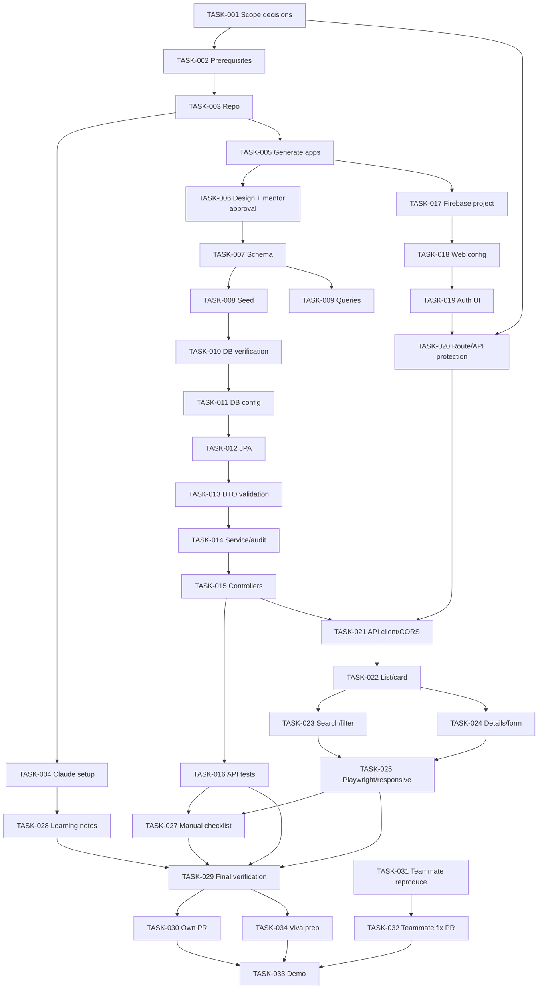

# Employee Directory (HR) — Actionable Task Backlog

**Baseline:** `implementation.md`  
**Source:** `Intern 1 - Employee Directory (HR) Onboarding Plan.pdf` (8 pages).  
**Status convention:** `Todo` until work is actually completed and verified.  
**Estimate unit:** person-hours; ranges include implementation and verification. These are planning estimates, not calendar commitments.  
**Priority:** `P0` required for source-defined completion; `P1` important supporting work; `P2` conditional/mentor decision.

> **Execution rule:** For every task, first explore without editing, list affected files, assumptions, acceptance criteria and tests, then wait for approval before implementation. Use small commits and never claim a test passes unless it was run and its output inspected.

---

## Epic E-00 — Scope, environment and repository

### TASK-001 — Confirm onboarding scope and resolve Day 3 security ambiguity
- **Priority:** P0 | **Estimate:** 0.5–1.0h | **Owner:** Intern + Mentor
- **Dependencies:** None
- **Requirements:** OUT-002, SEC-001, SEC-002, Q-001
- **Actions:**
  1. Review p.2 backend-token-verification statement and p.5 stretch-goal wording with mentor.
  2. Record whether Firebase Admin ID-token verification is required for acceptance.
  3. Confirm employee status values, required fields, email uniqueness semantics, audit fields and role expectations where possible.
  4. Record accepted decisions and unresolved items in `implementation.md` or `docs/decision-log.md`.
- **Acceptance criteria:**
  - [ ] Mentor decision for Q-001 is recorded.
  - [ ] Unspecified employee status values are not invented.
  - [ ] Any remaining assumptions are labelled and have an owner.
- **Verification:** Review decision record with mentor.

### TASK-002 — Install and verify local development prerequisites
- **Priority:** P0 | **Estimate:** 1–2h | **Owner:** Intern
- **Dependencies:** TASK-001
- **Requirements:** CON-001, OPS-001
- **Actions:**
  1. Install JDK 17+, Maven, MySQL 8 local, Node.js LTS and Git.
  2. Verify each executable/version in terminal.
  3. Confirm MySQL local service starts and local connection works.
  4. Record actual versions for README.
- **Acceptance criteria:**
  - [ ] JDK 17+ available.
  - [ ] Maven available.
  - [ ] MySQL 8 local instance reachable.
  - [ ] Node.js LTS and npm available.
  - [ ] Git available.
  - [ ] Actual versions recorded.
- **Verification:** Capture terminal version outputs; do not assume installation succeeded.

### TASK-003 — Create repository skeleton and safe Git baseline
- **Priority:** P0 | **Estimate:** 0.5–1h | **Owner:** Intern
- **Dependencies:** TASK-002
- **Requirements:** OUT-001, CON-002
- **Actions:**
  1. Create GitHub repository named `employee-directory`.
  2. Create `api/`, `web/`, `db/`, and documentation folders.
  3. Add `.gitignore` for `.env*` except approved example files, local DB config, build output, IDE files and secrets.
  4. Create initial branch; do not push to `main`.
  5. Confirm repository contains no credentials or real employee data.
- **Acceptance criteria:**
  - [ ] Repository name and folder structure match plan.
  - [ ] Feature branch workflow is active.
  - [ ] `.gitignore` excludes secrets and local config.
  - [ ] No credentials or real personal data are tracked.
- **Verification:** `git status`, inspect staged file list and `.gitignore`.

### TASK-004 — Configure Claude Code team setup and learning workflow
- **Priority:** P0 | **Estimate:** 1–2h | **Owner:** Intern + Mentor
- **Dependencies:** TASK-001, TASK-003
- **Requirements:** OPS-002, CON-003
- **Actions:**
  1. Obtain the actual team Claude Code configuration from mentor; do not invent it.
  2. Read and follow the four CLAUDE.md rules: think before coding, simplicity first, surgical changes, goal-driven execution.
  3. Warm up in an existing team repo: explain folder structure, entry point and tests without editing.
  4. Record five things learned.
  5. Use Context7 for current Spring Boot, React and Firebase Auth documentation.
  6. Note one incorrect Claude API suggestion if encountered; do not fabricate an example if none occurs.
  7. Keep explanatory output style enabled while learning.
- **Acceptance criteria:**
  - [ ] Team configuration works.
  - [ ] Warm-up was read-only.
  - [ ] Five learning notes recorded.
  - [ ] Current docs consulted.
  - [ ] No off-limits tools or connected-account actions used.
- **Verification:** Review notes/config with mentor.

### TASK-005 — Generate and run empty API and frontend applications
- **Priority:** P0 | **Estimate:** 1–2h | **Owner:** Intern
- **Dependencies:** TASK-002, TASK-003
- **Requirements:** OUT-001, CON-001
- **Actions:**
  1. Generate Spring Initializr API with Web, Data JPA, Validation and MySQL Driver.
  2. Generate Vite React frontend.
  3. Run both empty applications locally.
  4. Record exact startup commands and ports.
- **Acceptance criteria:**
  - [ ] API starts locally.
  - [ ] Vite React app starts locally.
  - [ ] Commands and ports are recorded.
  - [ ] No cloud deployment performed.
- **Verification:** Start each process and inspect successful startup output.

---

## Epic E-01 — Approved design and database

### TASK-006 — Produce ER diagram, endpoint list and React component tree
- **Priority:** P0 | **Estimate:** 1–2h | **Owner:** Intern
- **Dependencies:** TASK-001, TASK-005
- **Requirements:** DATA-001–008, FR-001–016
- **Actions:**
  1. Use `superpowers:brainstorming` before design.
  2. Propose `department`, `employee`, `employee_change` tables, keys, constraints and justified indexes.
  3. Define the five required API endpoints.
  4. Define React component tree including all six named components.
  5. List assumptions and trade-offs; do not write code or run SQL during design.
  6. Draw ER diagram yourself and save `db/er-diagram.mmd` (or approved diagram format).
  7. Present ERD, endpoint list and component tree at 15-minute mentor check-in.
- **Acceptance criteria:**
  - [ ] ER diagram contains all three required entities and relationships.
  - [ ] Endpoint list matches source routes.
  - [ ] Component tree includes EmployeeList, EmployeeCard, SearchBox, DepartmentFilter, EmployeeDetails and EmployeeForm.
  - [ ] Assumptions/trade-offs are visible.
  - [ ] Mentor approval recorded before Day 2 implementation.
- **Verification:** Mentor sign-off.

### TASK-007 — Implement MySQL schema
- **Priority:** P0 | **Estimate:** 1–2h | **Owner:** Intern
- **Dependencies:** TASK-006
- **Requirements:** DATA-001–006, SEC-006
- **Files:** `db/schema.sql`
- **Actions:**
  1. Create `department`, `employee`, `employee_change`.
  2. Add primary keys and required NOT NULL constraints.
  3. Add department and employee-change foreign keys.
  4. Add unique email constraint.
  5. Add only query-justified indexes.
  6. Use only a local database.
- **Acceptance criteria:**
  - [ ] All three tables created.
  - [ ] PK/FK/NOT NULL constraints exist where required.
  - [ ] Duplicate email is rejected by DB.
  - [ ] Employee with nonexistent department is rejected by DB.
  - [ ] Each index has a documented query rationale.
- **Verification:** Execute schema on a fresh local MySQL database; run negative inserts and inspect DB errors.

### TASK-008 — Create fake seed data
- **Priority:** P0 | **Estimate:** 0.5–1h | **Owner:** Intern
- **Dependencies:** TASK-007
- **Requirements:** DATA-007, SEC-005
- **Files:** `db/seed.sql`
- **Actions:**
  1. Insert 4 departments.
  2. Insert at least 15 fake employees.
  3. Insert several department/job-title change rows.
  4. Use synthetic data only.
- **Acceptance criteria:**
  - [ ] Exactly 4 departments or more, with at least 4.
  - [ ] At least 15 employees.
  - [ ] Some change-history records.
  - [ ] No real employee/customer data.
- **Verification:** Execute seed on fresh DB and query row counts.

### TASK-009 — Create five required SQL queries and manually inspect results
- **Priority:** P0 | **Estimate:** 1–2h | **Owner:** Intern
- **Dependencies:** TASK-007, TASK-008
- **Requirements:** DATA-008
- **Files:** `db/queries.sql`, `docs/sql-verification.md`
- **Actions:**
  1. Write commented headcount-per-department query.
  2. Write hires-in-last-90-days query.
  3. Write one employee's change-history query.
  4. Write employees-by-status query.
  5. Write departments-with-no-employees query.
  6. Run all five; manually check two result sets and record reasoning.
- **Acceptance criteria:**
  - [ ] Five queries present and commented.
  - [ ] Queries run successfully on seeded local DB.
  - [ ] Two results manually checked and documented.
- **Verification:** Execute each query and save observed output/notes.

### TASK-010 — Verify clean database rebuild and integrity constraints
- **Priority:** P0 | **Estimate:** 0.5–1h | **Owner:** Intern
- **Dependencies:** TASK-007, TASK-008, TASK-009
- **Requirements:** DATA-002–007, TEST-001
- **Actions:**
  1. Drop/recreate only the local test database as documented.
  2. Execute schema and seed scripts in order.
  3. Attempt insert with nonexistent department.
  4. Attempt duplicate email insert.
  5. Confirm both rejected.
- **Acceptance criteria:**
  - [ ] Fresh local DB rebuild succeeds from scripts.
  - [ ] Expected seed counts present.
  - [ ] Invalid department insert rejected.
  - [ ] Duplicate email insert rejected.
  - [ ] No shared/production DB touched.
- **Verification:** Record exact SQL commands and results.

---

## Epic E-02 — Spring Boot API

### TASK-011 — Configure API database connection safely
- **Priority:** P0 | **Estimate:** 0.5–1h | **Owner:** Intern
- **Dependencies:** TASK-005, TASK-010
- **Requirements:** SEC-003, OUT-001
- **Files:** `api/src/main/resources/application.properties`, ignored local config, example config
- **Actions:**
  1. Read DB credentials from environment variables or git-ignored `application-local.properties`.
  2. Commit example configuration only.
  3. Confirm API connects to local MySQL.
- **Acceptance criteria:**
  - [ ] API connects to local DB.
  - [ ] No DB password committed.
  - [ ] Example config contains placeholders only.
- **Verification:** Inspect Git tracking and start API.

### TASK-012 — Implement JPA entities and repositories
- **Priority:** P0 | **Estimate:** 1–2h | **Owner:** Intern
- **Dependencies:** TASK-007, TASK-011
- **Requirements:** DATA-001–006
- **Actions:**
  1. Implement Department, Employee and EmployeeChange entities.
  2. Map relationships and unique email constraint consistently with SQL schema.
  3. Implement repositories.
  4. Add employee search query supporting optional name and department ID.
  5. Keep repository free of HTTP concerns.
- **Acceptance criteria:**
  - [ ] Entity mappings match approved ERD/schema.
  - [ ] Repository can fetch all employees and filter by optional criteria.
  - [ ] Search + department filters combine with AND semantics (if approved).
  - [ ] No persistence entity is returned directly from controller.
- **Verification:** Repository tests or application context test.

### TASK-013 — Implement request/response DTOs and Bean Validation
- **Priority:** P0 | **Estimate:** 1–2h | **Owner:** Intern
- **Dependencies:** TASK-001, TASK-012
- **Requirements:** FR-005, FR-006, NFR-001
- **Actions:**
  1. Create employee create/update request DTOs and response DTOs.
  2. Add Bean Validation based on confirmed field rules.
  3. Validate email format and required fields as approved.
  4. Validate department ID presence/existence in service.
  5. Avoid returning internal entity fields.
- **Acceptance criteria:**
  - [ ] Invalid request is rejected as 400.
  - [ ] Valid request passes DTO validation.
  - [ ] Response DTO exposes only approved fields.
  - [ ] Validation rules match mentor-approved data contract.
- **Verification:** JUnit validation tests.

### TASK-014 — Implement service layer and employee change audit
- **Priority:** P0 | **Estimate:** 1–2h | **Owner:** Intern
- **Dependencies:** TASK-012, TASK-013
- **Requirements:** FR-006, FR-007, DATA-006
- **Actions:**
  1. Implement list/search, get, create and update service methods.
  2. Detect department and job-title changes against persisted values.
  3. Write `employee_change` row when either tracked field changes.
  4. Wrap employee update and audit insert in one transaction.
  5. Avoid audit rows when tracked values are unchanged.
- **Acceptance criteria:**
  - [ ] Valid employee create/update works.
  - [ ] Department change creates audit row.
  - [ ] Job-title change creates audit row.
  - [ ] Both changes in one update are captured.
  - [ ] Audit insert failure rolls back employee update.
- **Verification:** Service/integration tests inspecting both employee and audit rows.

### TASK-015 — Implement REST controllers and JSON error mapping
- **Priority:** P0 | **Estimate:** 1–2h | **Owner:** Intern
- **Dependencies:** TASK-013, TASK-014
- **Requirements:** FR-001–008, NFR-001
- **Actions:**
  1. Implement `GET /employees?name=&departmentId=`.
  2. Implement `GET /employees/{id}`.
  3. Implement `POST /employees`.
  4. Implement `PUT /employees/{id}`.
  5. Implement `GET /departments`.
  6. Add global exception handling for validation, missing IDs and unique conflicts.
  7. Return clear, stable JSON error body.
- **Acceptance criteria:**
  - [ ] All five source-listed endpoints exist.
  - [ ] Invalid input returns 400.
  - [ ] Unknown employee ID returns 404.
  - [ ] Duplicate email returns 409.
  - [ ] Error body is clear and contains no stack trace/secrets.
- **Verification:** HTTP/curl requests for success and each error case.

### TASK-016 — Write API tests using test-driven development
- **Priority:** P0 | **Estimate:** 2–3h | **Owner:** Intern
- **Dependencies:** TASK-012–015
- **Requirements:** TEST-002–009
- **Actions:**
  1. Use `superpowers:test-driven-development`.
  2. Write failing JUnit test for each API rule before implementation/fix.
  3. Test list/search/filter/combined filters.
  4. Test details, create, update.
  5. Test 400, 404 and 409 behavior.
  6. Test audit logging for department/job-title changes.
  7. Run `mvn test` and inspect complete output.
- **Acceptance criteria:**
  - [ ] Tests cover required API rules and negative cases.
  - [ ] Tests run with `mvn test`.
  - [ ] No tests disabled or weakened.
  - [ ] Actual test output reviewed.
- **Verification:** `mvn test`; preserve output in PR description or evidence notes.

---

## Epic E-03 — Firebase identity and API protection

### TASK-017 — Create development Firebase project and configure Email/Password
- **Priority:** P0 | **Estimate:** 0.5–1h | **Owner:** Intern
- **Dependencies:** TASK-001, TASK-005
- **Requirements:** FR-009–012
- **Actions:**
  1. Create personal development Firebase project.
  2. Enable Email/Password sign-in provider.
  3. Obtain web app configuration.
  4. Keep credentials/config out of committed secret files.
- **Acceptance criteria:**
  - [ ] Dev Firebase project exists.
  - [ ] Email/Password provider enabled.
  - [ ] Web configuration available for local app.
  - [ ] No service-account private key placed in frontend.
- **Verification:** Firebase console config review and test registration.

### TASK-018 — Configure frontend Firebase environment safely
- **Priority:** P0 | **Estimate:** 0.5h | **Owner:** Intern
- **Dependencies:** TASK-017
- **Requirements:** SEC-003, FR-009–012
- **Files:** `web/.env.local`, `web/.env.example`, `.gitignore`
- **Actions:**
  1. Put Firebase web config into `web/.env.local` using Vite `VITE_` variables.
  2. Git-ignore `.env.local`.
  3. Commit `.env.example` with placeholder values.
  4. Verify no actual secret values are staged.
- **Acceptance criteria:**
  - [ ] Local frontend reads Vite config.
  - [ ] `.env.local` is ignored.
  - [ ] `.env.example` is committed with placeholders only.
- **Verification:** `git check-ignore`, inspect `git status` and build output.

### TASK-019 — Implement Firebase Register, Login, Logout and auth state
- **Priority:** P0 | **Estimate:** 1–2h | **Owner:** Intern
- **Dependencies:** TASK-017, TASK-018
- **Requirements:** FR-009–012
- **Actions:**
  1. Ask Claude to explain Firebase Auth and `onAuthStateChanged` before coding.
  2. Implement auth initialization/provider.
  3. Implement Register, Login and Logout.
  4. Handle auth-pending state.
  5. Map wrong password, unknown user, email-in-use and weak-password errors to plain messages.
- **Acceptance criteria:**
  - [ ] User can register.
  - [ ] User can sign in.
  - [ ] User can sign out.
  - [ ] Auth state updates through `onAuthStateChanged`.
  - [ ] Four specified auth errors show plain messages.
- **Verification:** Manual Firebase auth flow in browser.

### TASK-020 — Protect all directory routes and resolve API token verification
- **Priority:** P0 for frontend route guard; P0/P1 for backend verification according to mentor decision | **Estimate:** 1–3h | **Owner:** Intern
- **Dependencies:** TASK-001, TASK-019
- **Requirements:** SEC-001, SEC-002, FR-013
- **Actions:**
  1. Implement `ProtectedRoute`; signed-out users go to Login.
  2. Do not render protected data while auth state is pending.
  3. If Q-001 requires backend enforcement: configure Firebase Admin SDK in Spring, keep service-account credentials server-side, verify ID token on every protected API request, and reject missing/invalid/expired tokens.
  4. Send current Firebase ID token as Bearer token from frontend API client.
  5. If mentor waives backend verification, record limitation clearly; never claim the API is protected by React route guards.
- **Acceptance criteria:**
  - [ ] Every directory route is protected.
  - [ ] Signed-out direct URL redirects to Login.
  - [ ] Protected UI does not flash before auth state resolves.
  - [ ] If backend verification required: every protected endpoint rejects missing/invalid/expired token and accepts valid token.
  - [ ] No Admin private key in frontend or Git.
- **Verification:** Playwright signed-out route test; API auth integration tests if enabled.

---

## Epic E-04 — React employee directory

### TASK-021 — Implement API client and CORS
- **Priority:** P0 | **Estimate:** 0.5–1h | **Owner:** Intern
- **Dependencies:** TASK-015, TASK-018, TASK-020
- **Requirements:** FR-001–008, SEC-010
- **Actions:**
  1. Configure frontend API base URL via environment config if needed.
  2. Implement API client for employee and department endpoints.
  3. Attach Firebase ID token when backend verification is enabled.
  4. Configure CORS for exact Vite development origin only.
- **Acceptance criteria:**
  - [ ] Browser can call API locally.
  - [ ] Search/filter parameters passed correctly.
  - [ ] Token attached when required.
  - [ ] CORS is not wildcard/open.
- **Verification:** Browser network inspection and CORS check.

### TASK-022 — Implement EmployeeList and EmployeeCard
- **Priority:** P0 | **Estimate:** 1–1.5h | **Owner:** Intern
- **Dependencies:** TASK-021
- **Requirements:** FR-001, FR-002, FR-009
- **Actions:**
  1. Implement `EmployeeList`.
  2. Implement `EmployeeCard`.
  3. Fetch employees from real API.
  4. Show loading, success, empty and API error states.
- **Acceptance criteria:**
  - [ ] Employee results display from API.
  - [ ] Loading state visible during fetch.
  - [ ] Empty result state is clear.
  - [ ] API failure is handled without app crash.
- **Verification:** Browser test with populated and empty query results.

### TASK-023 — Implement SearchBox and DepartmentFilter with combined behavior
- **Priority:** P0 | **Estimate:** 1–1.5h | **Owner:** Intern
- **Dependencies:** TASK-021, TASK-022
- **Requirements:** FR-002, FR-003
- **Actions:**
  1. Implement controlled `SearchBox`.
  2. Implement `DepartmentFilter` populated from `GET /departments`.
  3. Send both filters together to `GET /employees`.
  4. Ensure changing either filter preserves the other active filter.
  5. Add simple debounce only if needed; avoid speculative complexity.
- **Acceptance criteria:**
  - [ ] Search by name works.
  - [ ] Department filter works.
  - [ ] Combined filters work together.
  - [ ] Clearing one filter retains the other.
  - [ ] Empty combination produces correct empty state.
- **Verification:** Test name-only, department-only, both and neither.

### TASK-024 — Implement EmployeeDetails and EmployeeForm for add/edit
- **Priority:** P0 | **Estimate:** 1.5–2.5h | **Owner:** Intern
- **Dependencies:** TASK-013–015, TASK-022
- **Requirements:** FR-004–008
- **Actions:**
  1. Implement `EmployeeDetails`.
  2. Implement shared `EmployeeForm` for create/edit.
  3. Load department choices.
  4. Submit create to POST and edit to PUT.
  5. Display validation errors and duplicate email 409 on form.
  6. Refresh/replace displayed employee data after successful save.
- **Acceptance criteria:**
  - [ ] Details show employee information.
  - [ ] Add employee works.
  - [ ] Edit employee works.
  - [ ] Duplicate email error is shown clearly on form.
  - [ ] Invalid input messages are understandable.
  - [ ] API errors do not silently disappear.
- **Verification:** Browser walkthrough with valid and invalid submissions.

### TASK-025 — Verify responsive UI and Playwright flows
- **Priority:** P0 | **Estimate:** 1–2h | **Owner:** Intern
- **Dependencies:** TASK-019–024
- **Requirements:** TEST-010, NFR-002
- **Actions:**
  1. Use Playwright to click through UI in a real browser.
  2. Check desktop and mobile widths.
  3. Capture screenshots.
  4. Verify register, login, search/filter, add/edit, duplicate email, logout and signed-out protection.
- **Acceptance criteria:**
  - [ ] Desktop layout is usable.
  - [ ] Mobile layout is usable.
  - [ ] Screenshots captured and stored in project evidence.
  - [ ] Required core browser flows verified.
- **Verification:** Review Playwright run and screenshots.

---

## Epic E-05 — Documentation, verification and PRs

### TASK-026 — Write fresh-clone README
- **Priority:** P0 | **Estimate:** 1–1.5h | **Owner:** Intern
- **Dependencies:** TASK-002–025
- **Requirements:** OUT-001, OPS-003
- **Actions:**
  1. Document prerequisites and actual versions.
  2. Document DB creation/schema/seed steps.
  3. Document environment variables and example files.
  4. Document Firebase project/provider setup.
  5. Document API startup.
  6. Document web startup.
  7. Document tests and manual verification.
  8. Include troubleshooting for common setup failures without exposing secrets.
- **Acceptance criteria:**
  - [ ] README contains all required setup topics.
  - [ ] Commands are verified, not guessed.
  - [ ] Fresh clone can be set up using README alone.
- **Verification:** Test instructions from a fresh clone or clean local checkout.

### TASK-027 — Create manual test checklist with observed results
- **Priority:** P0 | **Estimate:** 0.5–1h | **Owner:** Intern
- **Dependencies:** TASK-016, TASK-025
- **Requirements:** TEST-010, OPS-004
- **Files:** `docs/manual-test-checklist.md`
- **Actions:**
  1. Add filter combinations.
  2. Add empty results and duplicate email.
  3. Add mobile width.
  4. Add register, wrong password, logout and signed-out protected page.
  5. Execute each test and record actual result, date/context and evidence.
- **Acceptance criteria:**
  - [ ] Every source-required manual case is present.
  - [ ] Each case has observed result (Pass/Fail/Blocked), not a prefilled pass.
  - [ ] Failures have issue/follow-up noted.
- **Verification:** Mentor reviews completed checklist.

### TASK-028 — Write Claude Code note and four-day learning log
- **Priority:** P0 | **Estimate:** 0.5–1h | **Owner:** Intern
- **Dependencies:** TASK-004, TASK-006–027
- **Requirements:** OPS-005, OUT-005
- **Files:** `docs/claude-code-notes.md`, `docs/daily-log.md`
- **Actions:**
  1. Record prompts used.
  2. Record at least one Claude suggestion accepted, changed or rejected and explain why.
  3. Complete daily log for Days 1–4: completed, verified/learned, suggestion changed/rejected.
  4. Record one line explaining props/state/hooks for each required React component.
- **Acceptance criteria:**
  - [ ] Prompts recorded.
  - [ ] One suggestion decision explained with evidence.
  - [ ] All four daily log rows completed.
  - [ ] Each required component has one learning note.
- **Verification:** Review docs before PR.

### TASK-029 — Run final verification and self code review
- **Priority:** P0 | **Estimate:** 1–2h | **Owner:** Intern
- **Dependencies:** TASK-010, TASK-016, TASK-020, TASK-025–028
- **Requirements:** OUT-001, TEST-001–010, SEC-001–010
- **Actions:**
  1. Rebuild local DB from scripts.
  2. Run `mvn test` and inspect output.
  3. Run manual test checklist.
  4. Run `superpowers:verification-before-completion`.
  5. Run `/code-review` on full diff.
  6. Use `code-simplifier` if code is over-built; do not alter scope.
  7. Address defects and rerun relevant checks.
- **Acceptance criteria:**
  - [ ] DB rebuild succeeds.
  - [ ] `mvn test` passes with output inspected.
  - [ ] Manual checklist has actual results.
  - [ ] Full diff reviewed.
  - [ ] No secrets or unrelated changes.
  - [ ] No tests disabled or validation weakened.
- **Verification:** Attach command/output evidence to PR.

### TASK-030 — Prepare own project PR and obtain mentor review
- **Priority:** P0 | **Estimate:** 0.5–1h plus review wait | **Owner:** Intern + Mentor
- **Dependencies:** TASK-029
- **Requirements:** OUT-004, OUT-005
- **Actions:**
  1. Ensure work is on feature branches, not main.
  2. Open PR for Employee Directory.
  3. Describe scope, design, tests, setup and known limitations.
  4. Request mentor review.
  5. Address every mentor comment before final demo.
- **Acceptance criteria:**
  - [ ] Own project PR opened.
  - [ ] Mentor review received.
  - [ ] Review comments addressed.
  - [ ] PR status accurately represented.
- **Verification:** PR URL and review record.

---

## Epic E-06 — Teammate Inventory Tracker bug fix

### TASK-031 — Obtain approved issue, clone and reproduce teammate bug
- **Priority:** P0 | **Estimate:** 1–2h | **Owner:** Intern + Mentor
- **Dependencies:** Mentor provides repo and issue; may be prepared in parallel with TASK-026
- **Requirements:** OUT-004, TEST-012, CON-004
- **Actions:**
  1. Get exact teammate repo and mentor-approved small issue.
  2. Clone repo.
  3. Build its database from scripts on local MySQL.
  4. Run API and UI.
  5. Reproduce bug before changing files.
  6. Use `superpowers:systematic-debugging` with the source-prescribed read-only investigation prompt.
  7. Record execution path, reproduction steps and likely root causes.
- **Acceptance criteria:**
  - [ ] Mentor-approved issue identified.
  - [ ] Local repo/database/API/UI run.
  - [ ] Bug reproduced before code change.
  - [ ] Root-cause hypotheses supported by evidence.
  - [ ] No unapproved changes made.
- **Verification:** Reproduction notes and mentor confirmation.

### TASK-032 — Write regression test, apply minimal fix and open teammate PR
- **Priority:** P0 | **Estimate:** 1–3h | **Owner:** Intern
- **Dependencies:** TASK-031
- **Requirements:** OUT-004, TEST-012
- **Actions:**
  1. Write failing regression test for reproduced bug.
  2. Confirm it fails for the expected reason.
  3. Apply smallest fix.
  4. Run regression and relevant existing tests.
  5. Open PR describing problem, root cause, fix and test output.
  6. Request mentor review and address comments.
- **Acceptance criteria:**
  - [ ] Regression test fails before fix.
  - [ ] Minimal fix applied.
  - [ ] Regression test passes after fix.
  - [ ] Relevant existing tests pass.
  - [ ] PR includes problem/root cause/fix/test output.
  - [ ] Mentor review received and comments addressed.
- **Verification:** Test output and PR review record.

---

## Epic E-07 — Final demo and knowledge transfer

### TASK-033 — Prepare and deliver 30-minute final demo
- **Priority:** P0 | **Estimate:** 0.5–1h preparation + 0.5h demo | **Owner:** Intern
- **Dependencies:** TASK-029, TASK-030, TASK-032
- **Requirements:** OUT-001, OUT-004, OUT-006
- **Actions:**
  1. Follow source agenda: DB/API/UI startup (2 min); live app walkthrough (8 min); tests/checklist (3 min); own PR/design decision (5 min); teammate fix (5 min); questions (7 min).
  2. Run everything locally from fresh clone using README.
  3. Demonstrate duplicate email error and sign-out behavior.
  4. Show both PRs and mentor review status.
- **Acceptance criteria:**
  - [ ] Fresh-clone setup demonstrated.
  - [ ] All six demo segments covered.
  - [ ] No unsupported claims about tests or security.
- **Verification:** Mentor acceptance/feedback.

### TASK-034 — Prepare to explain implementation and answer eight review questions
- **Priority:** P0 | **Estimate:** 1–2h | **Owner:** Intern
- **Dependencies:** TASK-012–032
- **Requirements:** OUT-005
- **Actions:**
  1. Trace React search request through controller, service, repository, JPA and MySQL back to UI.
  2. Explain controller/service/repository separation and entity vs DTO.
  3. Explain FK, unique email and index rationale.
  4. Explain combined filter semantics.
  5. Explain Firebase auth state vs backend token verification.
  6. Explain safe Firebase web config vs server-only secrets.
  7. Explain teammate bug root cause and regression test.
  8. Explain one Claude suggestion accepted/changed/rejected and rationale.
- **Acceptance criteria:**
  - [ ] Intern can explain all submitted code without asking Claude to explain it.
  - [ ] All eight source questions can be answered accurately.
- **Verification:** Mentor Q&A during demo.

---

## Dependency graph

## Day-by-day execution checklist

### Day 1 — Setup, stack tour and design
- [ ] TASK-001 Confirm scope/security ambiguity.
- [ ] TASK-002 Install JDK 17+, Maven, MySQL 8, Node.js LTS, Git.
- [ ] TASK-003 Create `employee-directory` with `api/`, `web/`, `db/`.
- [ ] TASK-004 Claude warm-up, five learning notes, Context7 docs.
- [ ] TASK-005 Generate/run empty Spring Boot and Vite React apps.
- [ ] TASK-017 Create personal dev Firebase project and enable Email/Password.
- [ ] TASK-006 ERD, endpoints and component tree; obtain mentor approval.

**Day 1 gate:** Do not proceed with Day 2 implementation design until mentor approves ERD, endpoint list and component tree.

### Day 2 — Database and API
- [ ] TASK-007 `db/schema.sql`.
- [ ] TASK-008 `db/seed.sql` (4 departments, 15+ employees, some change rows).
- [ ] TASK-009 `db/queries.sql` (five queries; manually check two).
- [ ] TASK-010 Fresh local DB rebuild and negative integrity checks.
- [ ] TASK-011 Safe DB credentials/config.
- [ ] TASK-012 Entities and repositories.
- [ ] TASK-013 DTOs and Bean Validation.
- [ ] TASK-014 Service and transactional audit log.
- [ ] TASK-015 Required REST endpoints and 400/404/409 errors.
- [ ] TASK-016 Failing-first JUnit tests and `mvn test`.

**Day 2 gate:** Rebuild DB from scripts, run `mvn test`, and show curl requests for each error case.

### Day 3 — React UI and Firebase login
- [ ] Create branch `feat/web` after confirming current branch/worktree.
- [ ] Use `superpowers:writing-plans` on approved component tree; review plan.
- [ ] TASK-018 Firebase web config and `.env.example`.
- [ ] TASK-019 Register/Login/Logout and auth-state listener.
- [ ] TASK-020 Protect every directory route; implement API token verification according to mentor decision.
- [ ] TASK-021 API client and Vite-origin-only CORS.
- [ ] TASK-022 EmployeeList/EmployeeCard.
- [ ] TASK-023 SearchBox/DepartmentFilter combined behavior.
- [ ] TASK-024 EmployeeDetails/EmployeeForm add/edit.
- [ ] TASK-025 Playwright desktop/mobile screenshots.
- [ ] Explain props/state/hooks for each component and record one line per component.

**Day 3 gate:** Register, sign in, search + filter, add an employee, sign out, and confirm directory is unreachable while signed out. Verify API authorization separately if enabled.

### Day 4 — Cross-repo fix, PRs and demo
- [ ] TASK-031 Clone teammate Inventory Tracker and reproduce mentor-approved bug.
- [ ] TASK-032 Failing regression test, smallest fix, passing tests, teammate PR.
- [ ] TASK-026 Complete README.
- [ ] TASK-027 Execute manual checklist and record results.
- [ ] TASK-028 Complete Claude note and daily log.
- [ ] TASK-029 Rebuild DB, run tests, manual checklist, verification-before-completion and `/code-review`.
- [ ] TASK-030 Open own PR; obtain mentor review and address comments.
- [ ] TASK-033 Deliver 30-minute demo.
- [ ] TASK-034 Answer eight technical questions and explain submitted code.

---

## Backlog-wide Definition of Done

A task is Done only when:
- Its stated output exists.
- Acceptance criteria are checked against actual behavior.
- Relevant tests/commands were run and output inspected.
- No secrets or real employee/customer data were exposed.
- Only task-required files changed.
- Code follows existing team conventions and is understandable to the intern.
- Documentation is updated where behavior/setup changed.
- Review comments are addressed where applicable.

**Blocker rule:** Raise blockers with the mentor within 30 minutes. Do not silently expand scope, bypass validation, disable tests, push to `main`, access shared/production databases, or deploy outside the local machine without explicit mentor approval.
